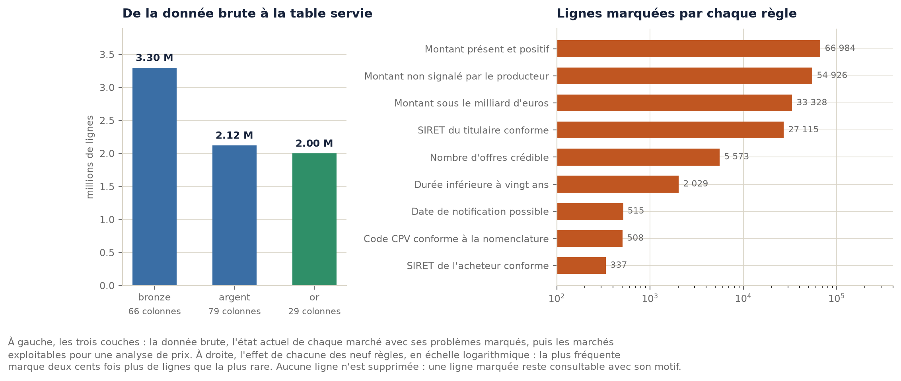
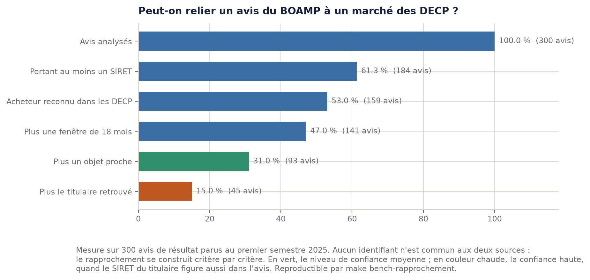
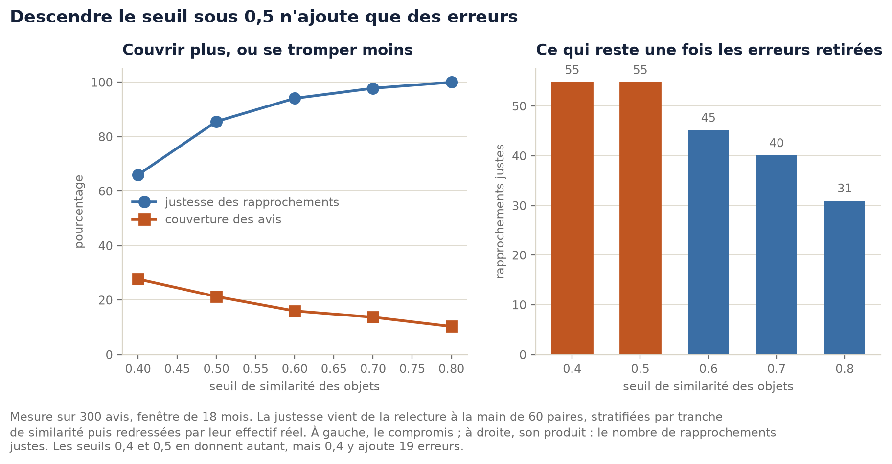

# Chapitre 4. Ingénierie des données : collecter, nettoyer, relier

> Brouillon. Les faits, les chiffres et les mesures sont vérifiés et reproductibles ; la
> formulation reste à reprendre dans la voix de l'auteur.

Le chapitre 1 a mesuré des données inexploitables en l'état : un total annuel faux d'un facteur dix
à vingt, des dates au 1er janvier de l'an 1, un même concept écrit de douze façons, et deux sources
qui ne se rejoignent pas. Ce chapitre décrit ce qui a été fait de ces données, et à quel prix.

Trois décisions commandent tout le reste, et elles sont énoncées d'abord parce que la suite n'en est
que la conséquence : **la donnée brute est conservée telle quelle**, **aucune ligne n'est jamais
supprimée**, et **les deux sources sont rapprochées avec un degré de confiance publié plutôt que
jointes avec une fausse certitude.**

---

## 4.1 Collecter sans abîmer les sources, et savoir ce qu'on a collecté

Jusqu'à la phase 3, les données étaient téléchargées à la main. Trois constats ont imposé un
service dédié.

**Les sources changent tous les jours.** Le jeu des données essentielles est republié chaque matin.
Une mesure faite le 20 septembre ne peut pas être refaite à l'identique le 21, sauf à savoir
précisément ce qui avait été téléchargé.

**Les sources tombent.** Trois interruptions réseau ont été rencontrées pendant l'exploration. Sans
reprise, une collecte de plusieurs minutes échoue entièrement sur un incident d'une seconde.

**Les interfaces publiques imposent des limites.** L'interface Recherche d'entreprises annonce sept
appels par seconde ; l'enrichissement complet des 242 745 SIRET à résoudre demande onze heures
d'appels.

Quatre propriétés sont donc tenues, et chacune est testée[^adr4].

| Propriété | Ce qu'elle garantit | Comment |
|---|---|---|
| **Traçabilité** | on sait exactement ce qui a été mesuré | manifeste portant l'adresse, la date, la taille et l'empreinte SHA-256 |
| **Idempotence** | relancer une collecte interrompue ne casse rien | fichier temporaire renommé seulement à la fin, entrée du manifeste remplacée et non ajoutée |
| **Rejouabilité** | corriger une règle ne demande pas de retélécharger | la donnée brute est conservée telle quelle, horodatée |
| **Ménagement des sources** | on ne dégrade pas un service public | six appels par seconde là où l'interface en annonce sept, reprise avec attente croissante |

L'idempotence mérite un mot, car son absence produit un défaut silencieux : sans fichier temporaire,
une coupure laisserait un Parquet incomplet portant le nom attendu, que la suite de la chaîne lirait
comme valide. **Les mesures seraient fausses sans que rien ne le signale.** Un test simule cette
coupure.

La reprise sur erreur, elle, distingue les cas : une erreur de serveur ou une coupure réseau sont
passagères et se retentent avec une attente qui double à chaque fois ; une ressource introuvable ne
se retente pas, car elle ne changera pas. Deux tests distincts vérifient les deux comportements, et
les quatorze tests de la collecte tournent **sans réseau** : ils vérifient le comportement du code,
pas la disponibilité d'une interface publique.

Première collecte réelle : 248,5 Mo pour les données essentielles, 36,5 Mo pour 2 000 avis du
bulletin d'annonces. Cette dernière borne n'est pas un choix : l'interface refuse de dépasser dix
mille enregistrements par requête, et la collecte complète devra se faire par tranches de dates.

---

## 4.2 Trois couches, et ce que chaque passage retire

| Couche | Promesse | Lignes | Colonnes |
|---|---|---|---|
| **bronze** | la donnée telle que la source l'a publiée. Aucune correction, aucun filtre | 3 296 811 | 66 |
| **argent** | nettoyée et normalisée, problèmes **marqués** et non retirés | 2 121 908 | 79 |
| **or** | prête à servir, ne contient que l'exploitable pour une analyse de prix | 1 999 474 | 29 |

Le passage de bronze à argent retire 1 174 903 lignes, qui sont **l'historique des modifications** :
chaque avenant ajoute une ligne, et la couche argent ne porte que l'état actuel de chaque marché. Ce
n'est donc pas un nettoyage, c'est une sélection d'état, et c'est la raison pour laquelle le mot
« doublon » était trompeur au chapitre 1.

Le passage d'argent à or retire 122 434 lignes de plus, celles qui sont inexploitables pour une
analyse de prix, **et qui restent consultables en argent avec le motif de leur exclusion**. Au
total, **94,2 % des lignes à l'état actuel sont exploitables**[^mesure-nettoyage].

Trois unités de comptage coexistent donc, et les confondre produit des pourcentages faux : 3,30
millions de lignes brutes, 2,12 millions de lignes à l'état actuel, 1,83 million de marchés
distincts. Chaque pourcentage de ce mémoire précise la sienne.

---

## 4.3 Marquer plutôt que supprimer : la décision la plus structurante

Chaque ligne de la couche argent conserve ses valeurs d'origine et reçoit neuf colonnes de qualité,
plus une colonne qui liste en clair les règles enfreintes.

| Règle | Ce qu'elle vérifie | Lignes marquées | Part des lignes à l'état actuel |
|---|---|---|---|
| montant renseigné | montant présent et positif | 66 984 | 3,157 % |
| montant sans anomalie signalée | montant non signalé par le producteur lui-même | 54 926 | 2,589 % |
| montant plausible | montant sous le milliard d'euros | 33 328 | 1,571 % |
| SIRET du titulaire valide | quatorze chiffres conformes | 27 115 | 1,278 % |
| offres plausibles | nombre d'offres crédible | 5 573 | 0,263 % |
| durée plausible | durée inférieure à vingt ans | 2 029 | 0,096 % |
| date plausible | date de notification possible | 515 | 0,024 % |
| CPV conforme | code conforme à la nomenclature | 508 | 0,024 % |
| SIRET de l'acheteur valide | quatorze chiffres conformes | 337 | 0,016 % |

**Trois raisons de marquer plutôt que de supprimer**, et elles valent d'être défendues une par une.

1. **Une ligne effacée ne peut plus être expliquée.** Devant un jury, « nous avons retiré 122 434
   lignes » appelle immédiatement « lesquelles, et pourquoi », et la réponse doit exister.
2. **Une ligne effacée ne peut plus être corrigée par l'administration qui l'a publiée.** Le projet
   peut, à terme, signaler à un acheteur que ses données sont fautives : encore faut-il les avoir.
   Le producteur lui-même tient ce raisonnement, puisqu'il publie ses propres rejets (chapitre 2).
3. **Une règle peut être mauvaise.** Le seuil d'un milliard d'euros est un choix discutable : le
   conserver comme un marquage permet de le changer et de tout rejouer, ce qu'une suppression
   interdit définitivement.

### Les seuils ne sont pas ronds par hasard

| Seuil | Valeur | Origine |
|---|---|---|
| Montant maximal | 1 milliard d'euros | le plus gros marché public français réel se compte en centaines de millions |
| Date minimale | 2015 | antérieure à l'obligation de publication de 2018, donc volontairement large |
| Durée maximale | 240 mois | vingt ans, ce qui laisse passer les concessions longues |
| Offres maximales | 500 | les marchés les plus concurrentiels en reçoivent quelques dizaines |

Chacun est un paramètre du modèle SQL, commenté à l'endroit où il s'applique, et non une valeur
enfouie dans du code. C'est ce qui rend l'analyse de sensibilité possible, et elle figure parmi les
mesures qui restent à faire.

---

## 4.4 La normalisation : douze écritures, six notions, deux fonctions SQL

La nature du marché s'écrit `Marché`, `MARCHE`, `MARCHÉ`, `marché` selon la source, conséquence
directe de l'agrégation de dizaines de sources ayant chacune ses habitudes de saisie.

| Notion après normalisation | Lignes | Écritures regroupées |
|---|---|---|
| MARCHE | 1 706 034 | 3 |
| ACCORD CADRE | 362 397 | 3 |
| MARCHE SUBSEQUENT | 43 807 | 2 |
| MARCHE DE PARTENARIAT | 620 | 2 |
| MARCHE DE DEFENSE OU DE SECURITE | 30 | 1 |
| CONCESSION DE SERVICE PUBLIC | 1 | 1 |

Douze écritures ramenées à six notions, par la mise en majuscules, le retrait des accents et la
normalisation de la ponctuation. Le cas qui résistait au chapitre 1, `ACCORD-CADRE` contre
`ACCORD CADRE`, est résolu par cette troisième fonction. **Toujours aucun modèle, toujours du SQL**,
et c'est la marche la plus basse de l'escalier qui suffit ici.

La dernière ligne du tableau est un rappel utile sur les données déclaratives : une seule ligne de
concession de service public dans deux millions, pour un type de contrat qui en compte des milliers
en France. Ce n'est pas la réalité, c'est une habitude de saisie.

---

## 4.5 Les tests de données, et les deux défauts qu'ils ont trouvés

Dix-huit tests de données portent sur les couches argent et or, et vingt tests d'intégration
exécutent la vraie chaîne sur un jeu fictif de quinze lignes dont chaque défaut est connu d'avance.
Ces derniers ont attrapé deux erreurs pendant l'écriture.

Les tests de données, eux, tournent sur le vrai jeu et ont trouvé deux défauts **qui n'étaient pas
cherchés**.

**Six lignes sans SIRET ni nom d'acheteur**, toutes de la même source. Des marchés dont on ne sait
pas qui les a passés.

**244 codes CPV qui ne sont pas des codes** : « Travaux », « lot 2000 », « X0000000 ». Des acheteurs
ont écrit du texte libre dans un champ de nomenclature. La règle ne déduit désormais une famille que
d'un code commençant réellement par deux chiffres, et marque le reste.

**La leçon de méthode est plus utile que les deux défauts.** Ils ont été trouvés parce qu'un contrat
de données avait été écrit, pas parce que quelqu'un les soupçonnait. Un contrat de données n'est pas
une formalité de qualité : c'est un dispositif qui découvre des faits.

### Et une erreur commise, dont la leçon porte un nom

Le premier contrat écrit exigeait un SIRET d'acheteur non nul **en couche argent**, et faisait
échouer la chaîne sur ces six lignes. Le contrat contredisait la promesse de la couche : la couche
argent s'engage à tout garder en marquant les problèmes, et y exiger un identifiant non nul revenait
à exiger qu'il n'y ait aucun problème à conserver.

Correction : un avertissement en couche argent, et la règle stricte déplacée en couche or, où elle
bloque à juste titre puisque cette couche ne contient que l'exploitable.

**La sévérité d'un test doit correspondre à ce que sa couche promet.** Un test trop strict finit
désactivé, et un test désactivé ne protège plus rien. C'est le mécanisme exact de l'échec Louvois
décrit au annexe B, où environ deux cents contrôles de cohérence jugés bloquants ont été
neutralisés « au lieu d'améliorer la fiabilité des saisies ».

---

## 4.6 dbt, le premier outil que ce projet adopte

Jusqu'à cette phase, le projet avait surtout écarté des outils. dbt est le premier retenu, et le
raisonnement mérite d'être exposé parce qu'il est l'inverse du précédent.

**La question n'est pas « dbt est-il bon » mais « qu'est-ce que je devrais écrire sans lui ».** La
réponse est : un lanceur, un système de tests de données, une génération de documentation et un
graphe de dépendances. Plusieurs semaines de travail pour refaire moins bien.

| Option | Pour | Contre | Verdict |
|---|---|---|---|
| **dbt** | SQL pur, tests de données intégrés, documentation et graphe automatiques, change de moteur sans réécrire | une dépendance, et un vocabulaire à apprendre | **retenu** |
| SQL et un lanceur maison | aucune dépendance, contrôle total | il faudrait réécrire exactement ce que dbt fournit | écarté |
| SQLMesh | plus moderne, gère mieux l'incrémental | communauté plus petite, et le besoin d'incrémental n'est pas démontré | à reconsidérer |
| pandas ou polars | familier | la transformation quitte le SQL, donc le moteur ne peut plus l'optimiser, et on perd la lisibilité pour un relecteur non développeur | non |

Ce choix a une conséquence qui vaut d'être dite : dbt sait exécuter les mêmes modèles sur DuckDB et
sur PostgreSQL. Le site a donc pu être servi sans réécrire une seule règle de nettoyage. La chaîne
complète prend environ six secondes sur le Mac, ce qui reste à remesurer sur le VPS.

---

## 4.7 Relier le BOAMP et les DECP : un rapprochement, pas une jointure

C'est l'apport que ce mémoire revendique comme le plus original, et c'est aussi le plus incertain.

Le chapitre 1 a mesuré le problème : sur 600 avis récents portant un identifiant de dossier, **aucun
ne correspond à un identifiant des données essentielles**. Les deux sources désignent les mêmes
marchés sans jamais se rencontrer, parce que l'une porte un identifiant technique produit par la
plateforme de dématérialisation et l'autre un numéro de dossier choisi par l'acheteur.

### L'escalier, appliqué au rapprochement

Chaque niveau ajoute un critère, et chaque niveau est mesuré séparément pour savoir ce qu'il
apporte. Mesure du 21 septembre 2026, sur 300 avis de résultat parus au premier semestre 2025.

| Niveau | Critère ajouté | Avis rapprochés | Part des 300 |
|---|---|---|---|
| 0 | avis portant au moins un SIRET | 184 | 61,3 % |
| 1 | ce SIRET est un acheteur connu des données essentielles | 159 | 53,0 % |
| 2 | plus au moins un marché dans une fenêtre de 18 mois | 142 | 47,3 % |
| 3 | plus un objet de marché suffisamment proche | 93 | 31,0 % |
| 4 | plus le SIRET du titulaire retrouvé dans le même avis | 44 | 14,7 % |

**Le plafond du dispositif ne dépend pas de nous** : seuls 61,3 % des avis portent un SIRET
exploitable. Pour y arriver, il a fallu d'ailleurs chercher au bon endroit : les avis existent en
trois formats, et le SIRET semblait manquer dans 81 % d'entre eux avant qu'on découvre qu'il se
trouvait ailleurs selon le format. Une expression régulière cherchant un motif de quatorze chiffres
dans tout le document fonctionne sur les trois, et son imprécision est rattrapée par la
vérification : un nombre qui n'est pas un SIRET ne correspondra à aucun acheteur connu.

### Trois issues plutôt que deux, et c'est du Fellegi et Sunter

Les niveaux 3 et 4 ne sont pas concurrents mais complémentaires : le niveau 4 donne une quasi
certitude quand il aboutit, le niveau 3 couvre davantage de cas avec une confiance moindre. Le
rapprochement produit donc un **degré de confiance** et non un booléen, exactement comme le cadre
posé en 1969 (annexe B).

| Confiance | Règle | Usage |
|---|---|---|
| Haute | acheteur, fenêtre de dates et SIRET du titulaire concordent | le lien s'affiche |
| Moyenne | acheteur, fenêtre, objet proche, un seul candidat | le lien s'affiche **avec sa mention de doute** |
| Faible | acheteur et fenêtre seulement, plusieurs candidats | usage interne, jamais affiché |

### La justesse, mesurée à la main, et le résultat qui a changé le réglage

**Un taux de rapprochement ne dit rien de sa justesse.** Soixante paires ont donc été relues une par
une, douze par tranche de similarité, avec un verdict écrit et versionné.

| Tranche de similarité | Justes | Fausses | Doutes | Justesse |
|---|---|---|---|---|
| 0,4 à 0,5 | 0 | 12 | 0 | 0 % |
| 0,5 à 0,6 | 6 | 4 | 2 | 60 % |
| 0,6 à 0,7 | 8 | 3 | 1 | 72,7 % |
| 0,7 à 0,8 | 10 | 1 | 1 | 90,9 % |
| 0,8 et plus | 12 | 0 | 0 | 100 % |

**Les 19 paires où le SIRET du titulaire concorde sont toutes justes.** Le niveau 4 mérite donc son
nom de confiance haute, et cette fois la mesure le prouve au lieu de le supposer.

En croisant ces verdicts avec un balayage de seuils, et en pondérant chaque tranche par son effectif
réel (l'échantillon relu est stratifié, une moyenne simple serait fausse) :

| Seuil | Rapprochés | Couverture | Justesse estimée | Rapprochements justes attendus |
|---|---|---|---|---|
| 0,4 | 83 | 27,7 % | 66,0 % | **54,8** |
| 0,5 | 64 | 21,3 % | 85,6 % | **54,8** |
| 0,6 | 48 | 16,0 % | 94,1 % | 45,2 |
| 0,7 | 41 | 13,7 % | 97,8 % | 40,1 |
| 0,8 | 31 | 10,3 % | 100 % | 31,0 |

**Résultat décisif : les seuils 0,4 et 0,5 produisent le même nombre de rapprochements justes.**
Descendre sous 0,5 n'apporte donc aucune information utile, seulement dix-neuf erreurs
supplémentaires. Ce constat était impossible à deviner, et il justifie à lui seul le temps passé à
relire soixante paires à la main.

Deuxième enseignement, négatif celui-là : la fenêtre de dates ne trie presque rien. De 6 à 36 mois,
le nombre d'avis avec candidats passe de 137 à 147, et la fenêtre laisse en médiane une centaine de
marchés candidats. **C'est le seuil de similarité qui discrimine**, donc c'est lui qu'il faut
régler.

**Réglage retenu** : fenêtre de 18 mois, seuil de 0,6, soit 94,1 % de justesse pour 16 % de
couverture[^adr3].

### Les limites, énoncées plutôt que tues

Les soixante verdicts ont été posés par **une seule personne**, sur lecture des libellés. Deux
libellés proches peuvent désigner deux lots d'un même marché, ce qui est un rapprochement
acceptable, ou deux marchés distincts, ce qui ne l'est pas. Un second relecteur changerait
probablement quelques verdicts, sans modifier la tendance. La comparaison de texte utilise par
ailleurs la bibliothèque standard : une bibliothèque spécialisée serait dix à cent fois plus rapide,
ce qui n'importe pas sur 300 avis mais importera sur plusieurs centaines de milliers.

---

## 4.8 Enrichir par le répertoire des entreprises, et une leçon sur les échantillons

Les SIRET des titulaires sont résolus auprès de l'interface publique Recherche d'entreprises, ce qui
donne la taille de l'entreprise, donc la part des marchés attribués à des PME. 242 745 SIRET sont à
résoudre, à six appels par seconde : onze heures d'appels, menées par tranches.

Cette résolution a produit la principale leçon de méthode du projet sur les échantillons. Un premier
essai portait sur les soixante **plus gros** titulaires, et donnait 5 % de PME. Un tirage aléatoire
sur le même jeu donne 59,2 %. Le premier chiffre n'était pas faux, il répondait à une autre
question : « parmi les plus gros titulaires, combien de PME ». **Choisir un échantillon au lieu de le
tirer revient à choisir sa réponse.** Le chiffre publié, avec son encadrement, est de 60,8 % des
attributions résolues, encadré entre 56,7 % et 63,5 % (chapitre 8).

---

## 4.9 Trois pièges d'identifiant, trouvés en chemin

Ils n'étaient pas cherchés, et chacun a coûté du temps avant d'être compris.

**L'identifiant de marché n'identifie pas une ligne.** 140 350 identifiants apparaissent plusieurs
fois, soit 281 404 lignes en trop sur 2 054 924, et **619 identifiants portent des montants
contradictoires** d'une ligne à l'autre. Un marché a autant de lignes que de titulaires. Ce défaut a
été découvert indirectement, en cherchant pourquoi un calcul n'était pas reproductible
(chapitre 5), et il est maintenant mesuré.

**Aucune clé de ligne n'existe en couche or.** 1 999 474 lignes pour 1 738 289 numéros de marché, et
136 lignes strictement identiques à une autre. Aucune colonne ni combinaison de colonnes n'identifie
une ligne. Conséquence : une clé technique est fabriquée, et le projet renonce aux clés étrangères.

**Les unités de comptage se confondent facilement.** Le nombre d'offres reçues est renseigné sur
899 298 lignes et concerne 800 782 marchés distincts : diviser le premier nombre par le nombre de
marchés donne 49 %, la bonne réponse est 43,7 %. Avant toute division, il faut demander ce qu'une
ligne représente. La même erreur a produit, en phase 7, un total de 1 500,9 milliards d'euros
affiché en page d'accueil, surcompté de 36,7 % par les groupements d'entreprises.

---

## 4.10 Ce qui reste à faire sur cette couche

Six points sont ouverts, et ils sont listés pour que le jury n'ait pas à les deviner.

| Point ouvert | Pourquoi il compte |
|---|---|
| Comparer avec les jeux officiels des marchés valides et exclus | une validation externe de notre nettoyage, par les critères du producteur |
| Éclaircir l'écart sur les titulaires : 213 703 mesurés contre 217 199 publiés | un écart de 1,6 % non expliqué reste un écart |
| Mesurer la sensibilité du seuil d'un milliard d'euros | combien de marchés réels se situent entre 100 millions et 1 milliard |
| Un second relecteur sur les soixante paires rapprochées | une justesse mesurée par une seule personne reste un avis |
| Les motifs de signalement et quelques libellés sont sans accents | à corriger dans la couche de transformation, pas à l'affichage |
| Certains objets de marché contiennent du HTML venu de la source | honnête mais laid, à nettoyer en transformation |

---

[^adr4]: ADR 0004, `docs/adr/0004-collecte-et-couche-bronze.md`. Journal de la phase 3,
`docs/journal/2026-09-28-collecte.md`.

[^mesure-nettoyage]: Mesure propre, `make bench-nettoyage`, 28 septembre 2026. Agrégats dans
`mesures/resultats/nettoyage-couches.csv`, `nettoyage-regles.csv` et `nettoyage-normalisation.csv`.
Décision tracée dans l'ADR 0005.

[^adr3]: ADR 0003, `docs/adr/0003-rapprochement-des-sources.md`. Mesures `make bench-rapprochement`,
21 et 27 septembre 2026. Verdicts manuels dans
`mesures/verification/2026-09-27-verdicts-rapprochement.csv`, agrégats dans
`mesures/resultats/rapprochement-precision.csv`.
