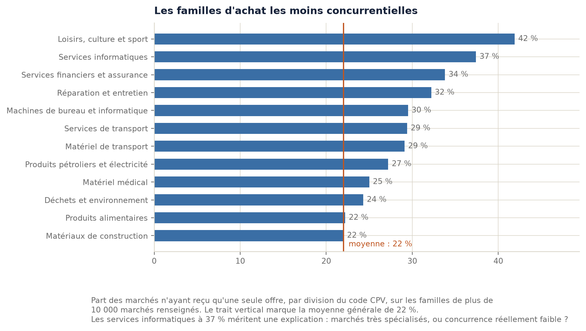
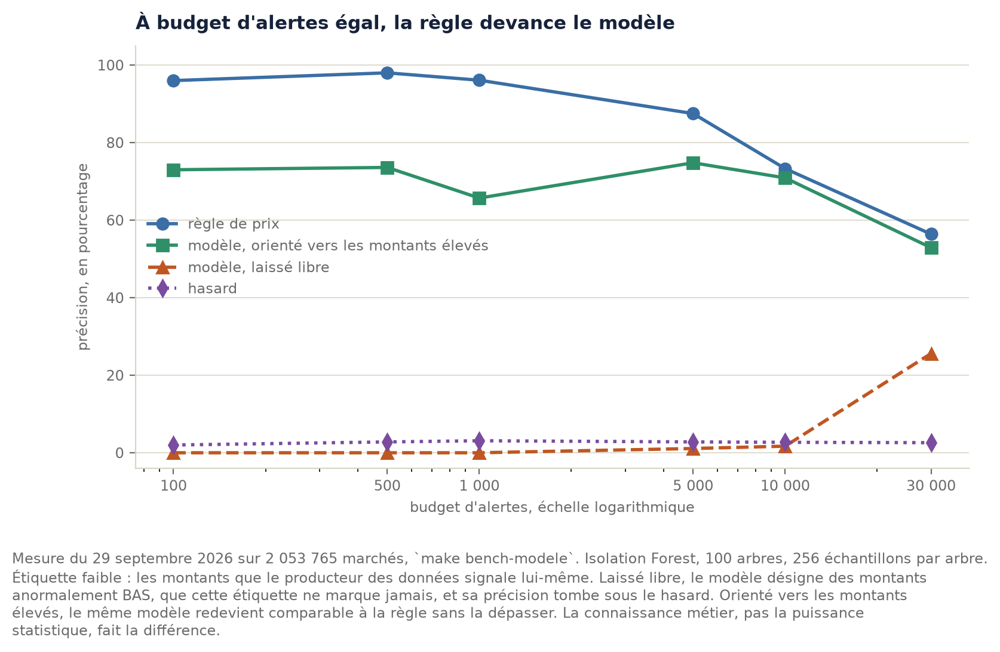

# Chapitre 5. Détecter les marchés atypiques, et refuser un modèle par la mesure

> Brouillon. Les faits, les chiffres et les mesures sont vérifiés et reproductibles ; la
> formulation reste à reprendre dans la voix de l'auteur.

Deux millions de marchés propres ne servent à rien si personne ne sait lesquels regarder. Ce
chapitre construit cette orientation du regard, et il aboutit à une conclusion que l'époque rend
inconfortable : **dix méthodes d'apprentissage automatique ont été comparées à une statistique
descriptive tenant en une ligne de SQL, et aucune ne l'a dépassée.**

Ce résultat n'est pas un parti pris. Il est la sortie d'un protocole annoncé à l'avance, avec
l'engagement écrit de publier le verdict même s'il était défavorable aux règles. Le chemin qui y
mène compte autant que la conclusion, parce qu'il a produit quatre découvertes qui n'étaient pas
prévues.

---

## 5.1 Trois contraintes, dont une qui exclut d'emblée la méthode la plus performante

**Il n'existe aucune vérité de référence.** Personne ne publie la liste des marchés irréguliers.
L'apprentissage supervisé est donc impossible, non par choix mais par absence d'étiquettes. C'est la
contrainte qui sépare ce problème de ceux d'OTTO ou d'Airbnb (annexe C), qui disposent du clic et
de la réservation.

**Un faux signalement coûte plus cher qu'un signalement manqué.** Le service s'adresse au public.
Signaler à tort un marché régulier abîme la confiance et peut nuire à une entreprise nommée.

**Le résultat doit s'expliquer.** Un jury, un acheteur ou un journaliste demanderont pourquoi tel
marché est signalé. « Le modèle l'a décidé » n'est pas une réponse acceptable, et le annexe B en
donne le précédent judiciaire avec l'affaire Air Canada.

---

## 5.2 Des variables, pas des colonnes : un marché se juge par rapport à ses pairs

Une colonne est reçue, une variable est fabriquée. Le principe qui guide toute cette couche tient en
une phrase : **un marché de voirie à 500 000 euros n'est ni cher ni bon marché ; il l'est par
rapport aux autres marchés de voirie.** Trois groupes de comparaison sont donc construits.

| Groupe | Ce qu'il permet de juger | Variable principale |
|---|---|---|
| la famille d'achat (code CPV) | un prix | écart normalisé à la médiane du groupe |
| l'acheteur | une habitude d'attribution | part des marchés allant à un même titulaire |
| le couple acheteur et titulaire | une relation | nombre de marchés remportés ensemble |

Deux choix de calcul méritent d'être défendus, car ils viennent directement des mesures du
chapitre 1.

**L'écart est calculé sur le logarithme du montant**, parce que la distribution des montants est
log-normale. Comparer des montants bruts donnerait un poids démesuré aux gros marchés et rendrait
tout petit marché normal par construction.

**La dispersion est mesurée par l'écart interquartile plutôt que par l'écart type.** Sur des données
où une ligne sur trente porte un montant fantaisiste, l'écart type est lui-même faussé par ces
valeurs : une valeur extrême gonfle la dispersion et **se masque elle-même**. La section 5.8 montre
que cette précaution, pourtant justifiée, n'a pas pu être départagée par la mesure.

---

## 5.3 Les cinq signaux, et leurs seuils

| Signal | Règle | Marchés désignés | Part des lignes de la couche or |
|---|---|---|---|
| Prix très élevé | écart normalisé supérieur à 4, dans un groupe d'au moins 30 marchés | 2 661 | 0,13 % |
| Prix élevé à vérifier | écart entre 3 et 4 | 17 418 | 0,87 % |
| Prix très bas, **non évalué** | écart inférieur à moins 4 | 18 954 | 0,95 % |
| Offre unique sur un marché au-dessus des seuils | une seule offre reçue et montant supérieur à 214 000 euros | 53 328 | 2,67 % |
| Titulaire dominant | plus de la moitié des marchés d'un acheteur qui en passe au moins dix | 1 656 | 0,08 % |
| **Au moins un signal fort** | prix très élevé, offre unique ou titulaire dominant | **57 409** | **2,87 %** |
| Deux signaux forts indépendants | | 236 | 0,01 % |

Mesure du 28 septembre 2026[^mesure-detection]. L'unité de comptage est la ligne de la couche or, et
« au moins un signal fort » **exclut** les deux niveaux faibles : le prix à vérifier et le signal non
évalué. Un comptage incluant tous les motifs de signalement, quel que soit leur niveau, donne 76 309
marchés, soit 3,8 %. Les deux chiffres ne mesurent pas la même chose, et c'est précisément pourquoi
chacun porte sa définition.

### Deux précautions écrites dans le code

**La taille du groupe de comparaison.** Dans une famille de trois marchés, la médiane est calculée en
incluant le marché examiné : le comparer à elle revient à le comparer à lui-même. C'est une fuite de
données, discrète et réelle. Le seuil de trente marchés l'évite.

**Le seuil des 214 000 euros sur l'offre unique n'est pas arbitraire.** Le chapitre 1 a mesuré que
l'offre unique est banale sur les petits marchés, 27,1 % sous 25 000 euros, et plus rare sur les
gros, 16,2 % au-dessus de dix millions. Le signal ne se déclenche donc qu'au-dessus du seuil de
procédure formalisée, là où une offre unique est réellement inhabituelle. **Le signal utile n'est
jamais « une seule offre », c'est « une seule offre là où on en attendait plusieurs ».**

### Ce que la littérature propose, et ce que les données permettent

Les indicateurs retenus viennent de la littérature, pas de l'intuition. Le tableau suivant dit
lesquels sont calculables sur les données essentielles françaises, et pourquoi les autres ne le sont
pas[^litterature].

| Indicateur de la littérature | Calculable ici | Pourquoi |
|---|---|---|
| Offre unique en marché concurrentiel (Fazekas et Kocsis ; R018) | **oui**, sur 43,7 % des marchés | le champ existe, mais il est renseigné pour moins de la moitié des marchés |
| Recours aux procédures non concurrentielles (R013, R049) | **oui** | le type de procédure est publié |
| Concentration des attributions chez un titulaire | **oui**, sur 100 % des marchés | calculable sans aucun champ facultatif |
| Délai de dépôt des offres trop court (R003, R014, R061) | **non** | les données essentielles ne portent ni la date de publication de l'avis ni la date limite |
| Durée de publicité anormale (composante du CRI) | **non** | même raison |
| Fractionnement sous les seuils (R011) | pas encore | calculable en principe, non implémenté |

Ce tableau justifie à lui seul le rapprochement du chapitre 4 : **trois des six composantes de
l'indice composite de la littérature sont des délais de procédure, que seul le bulletin d'annonces
contient.** Relier les deux sources n'est donc pas un ornement, c'est la condition pour calculer les
indicateurs reconnus.

---

## 5.4 L'étiquette faible, et pourquoi la précision annoncée est un minorant

Faute de vérité de référence, l'évaluation utilise une **étiquette faible** : les montants que le
producteur des données signale lui-même comme suspects ou aberrants.

| Sens | Seuil | Signalés | Précision | Rappel |
|---|---|---|---|---|
| trop cher | 3 | 33 600 | 55,1 % | 34,0 % |
| trop cher | **4** | 8 331 | **75,8 %** | 11,6 % |
| trop cher | 5 | 3 535 | 92,6 % | 6,0 % |
| **trop bas** | 4 | 18 208 | **0,0 %** | 0,0 % |
| les deux mélangés | 4 | 26 539 | 23,8 % | 11,6 % |

**La précision affichée est un minorant, et il faut le redire chaque fois que le chiffre est cité.**
L'étiquette est elle-même produite par un détecteur : un marché que nous signalons sans qu'il l'ait
signalé peut être une anomalie qu'il a manquée, et non une erreur de notre part. Annoncer « 75,8 % »
sans cette précaution serait malhonnête, et un jury attentif le relèverait.

Le choix de deux niveaux plutôt qu'un seul seuil découle directement de ce tableau : au seuil 4, la
précision est bonne mais le rappel faible ; au seuil 3, le rappel triple et la précision tombe de
vingt points. Les deux sont donc exposés, le premier comme signal fort, le second comme invitation à
vérifier.

---

## 5.5 L'erreur la plus instructive du projet : une valeur absolue

**Symptôme.** Une mesure d'essai donnait 75,8 % de précision. Le script écrit ensuite, censé faire
la même chose, en donnait 23,8 %. Trois fois moins, sur les mêmes données et au même seuil.

**Cause.** La mesure d'essai testait « écart supérieur à 4 », le script testait « valeur absolue de
l'écart supérieure à 4 ». Une valeur absolue ajoutée sans y penser, parce qu'elle semblait plus
complète.

**Ce que la mesure a révélé.** Les montants **trop bas** ne concordent **jamais** avec les anomalies
signalées par le producteur : zéro concordance sur 18 208 marchés. En mélangeant les deux
directions, on noyait un signal valide dans un signal non évaluable.

**La leçon, et elle est générale : une évaluation ne dit rien sur ce que son étiquette ignore.** Le
réflexe aurait été de conclure que la détection des montants bas est mauvaise. La conclusion juste
est qu'**elle n'est pas évaluable avec cette étiquette**. Confondre « non validé » et « invalide »
aurait supprimé un signal peut-être utile : un marché de travaux à un euro est tout aussi anormal
qu'un marché à cent millions. Le signal existe donc, il est exposé, et il porte à l'écran la mention
« non évalué ».

---

## 5.6 Le protocole de comparaison, et les deux métriques écartées

**À budget d'alertes égal.** Pour un nombre d'alertes donné, on prend les N marchés les mieux classés
par chaque méthode et on compare leur précision. Comparer une règle qui signale 8 331 marchés à un
modèle qui en signale 60 000 ne dirait rien : le second trouverait mécaniquement plus d'anomalies, et
mécaniquement plus de faux.

| Métrique | Pourquoi elle est là |
|---|---|
| précision à budget | c'est la contrainte réelle de l'analyste, qui n'a pas un temps infini |
| précision moyenne | résume le classement entier, adaptée aux classes rares |
| aire sous la courbe ROC | montrée **pour être critiquée** : elle reste flatteuse quand les positifs sont rares |
| durée | un modèle qui demande des heures ne tient pas sur un VPS à 23,50 euros |
| ~~taux de bonnes réponses~~ | répondre « rien à signaler » partout donne 97,3 % |
| ~~rappel seul~~ | signaler les deux millions de marchés donne 100 % de rappel |

Les deux dernières lignes ne sont pas une coquetterie. Ce sont les deux métriques qu'un rapport
pressé aurait citées, et chacune aurait permis d'annoncer un excellent résultat sans rien détecter.

---

## 5.7 Dix méthodes, et le résultat

Précision à budget d'alertes égal, sur les 2 053 765 marchés du jeu évalué le 29 septembre 2026.

| Budget | Règle | Modèle libre | Modèle orienté | Hasard |
|---|---|---|---|---|
| 100 | **96,0 %** | 0,0 % | 73,0 % | 2,0 % |
| 500 | **98,0 %** | 0,0 % | 73,6 % | 2,8 % |
| 1 000 | **96,1 %** | 0,0 % | 65,7 % | 3,1 % |
| 5 000 | **87,5 %** | 1,1 % | 74,8 % | 2,8 % |
| 10 000 | **73,3 %** | 1,7 % | 70,9 % | 2,7 % |
| 30 000 | **56,4 %** | 25,6 % | 52,9 % | 2,6 % |

Le banc complet, en précision moyenne, avec et sans orientation du score. Les quatre méthodes du
tableau précédent sont celles du banc stabilisé, rejouable par une commande ; les dix suivantes
viennent du notebook de modélisation, rejouable lui aussi mais plus long :

| Méthode | Libre | Orientée | Durée |
|---|---|---|---|
| 1. écart à la moyenne, global | 49,66 % | 49,64 % | instantané |
| 2. écart à la moyenne, par famille | **50,22 %** | **50,20 %** | instantané |
| 3. écart robuste à la médiane, **la règle du projet** | 47,12 % | 47,11 % | instantané |
| 4. k-moyennes, normalisation standard | 9,44 % | 24,36 % | 0,6 s |
| 5. k-moyennes, normalisation robuste | 7,01 % | 16,05 % | 0,5 s |
| 6. analyse en composantes principales, erreur de reconstruction | 19,86 % | 50,04 % | 0,1 s |
| 7. enveloppe elliptique | 6,33 % | 12,79 % | 1,9 s |
| 8. machine à vecteurs de support à une classe | 4,27 % | 6,79 % | 1,0 s |
| 9. Isolation Forest | 17,46 % | 41,32 % | 4,7 s |
| 10. facteur local d'aberration | 3,96 % | 6,83 % | 15,8 s |

Le coût est l'autre moitié du résultat : la règle est **déjà calculée en SQL**, donc gratuite à
l'évaluation, là où le modèle demande 0,38 seconde de lecture, 0,57 seconde d'entraînement et 3,98
secondes d'application sur deux millions de lignes[^cout-modele].

---

## 5.8 Quatre choses que la mesure a apprises, et qui n'étaient pas prévues

### 1. Un modèle sous le hasard n'est pas un mauvais modèle

Isolation Forest obtient **0 %** de précision sur les petits budgets, là où un tirage aléatoire en
obtient 2 à 3 %. La conclusion facile était écrite d'avance. Avant de la garder, les marchés
désignés par le modèle ont été ouverts : écart médian de **moins 8,2**, montant médian de **0,20
euro**, 468 offres reçues. Ce sont des montants anormalement **bas**, que l'étiquette ne marque
jamais.

La métrique ne mesurait donc pas la qualité du modèle, elle mesurait un désaccord de direction.
Orienté du même côté que la règle, **sans qu'une seule ligne de son apprentissage ne change**, le
modèle passe de 0 à 73 % sur les cent premières alertes.

C'est la même leçon que la section 5.5, appliquée cette fois au modèle. Et c'est, au fond,
l'argument central de ce chapitre : **les modèles ne trouvent des valeurs extrêmes qu'une fois qu'on
leur a dit de quel côté regarder, et cette connaissance vient du métier, pas des données.** Une
règle la porte en clair et l'explique à l'utilisateur ; un modèle ne l'a que si on la lui impose de
l'extérieur, et il ne peut alors plus rien expliquer de sa décision.

### 2. Les versions naïves battent légèrement la version robuste

Attendu : la médiane et l'écart interquartile devaient l'emporter sur la moyenne et l'écart type.
Mesuré : les deux versions naïves font un peu **mieux**, 49,7 % et 50,2 % contre 47,1 %.

L'explication est la limite centrale de cette évaluation : l'étiquette est un détecteur de gros
montants, et l'écart à la famille est corrélé à **0,98** au montant brut. Classer par montant donne
donc presque raison d'avance.

**Conséquence à énoncer, et elle est gênante : cette étiquette ne sait pas départager ces trois
variantes.** Elle valide une direction de recherche, pas la finesse d'un calcul. Le choix de la
version robuste repose donc aujourd'hui sur un argument de méthode, non sur une mesure. Le départage
demande un échantillon jugé à la main, et c'est le premier point de la suite.

### 3. Une option avait été écartée sur une idée reçue

Le facteur local d'aberration avait été écarté pour « coût quadratique, impraticable sur deux
millions de lignes ». Mesure : la durée **par ligne** n'augmente que de 60 % quand la taille passe de
25 000 à 400 000 lignes, là où un coût quadratique l'aurait multipliée par seize, et la méthode
traite le jeu complet en 15,8 secondes. En cinq dimensions, la bibliothèque indexe les points dans un
arbre et la recherche de voisins devient quasi linéaire ; la mauvaise réputation de cette méthode
vient de son comportement en grande dimension.

La méthode est donc praticable. Elle est simplement mauvaise ici. **L'écarter reste justifié, mais
pour la bonne raison**, et la différence compte devant un jury.

### 4. Une graine fixe ne suffit pas à rendre un calcul reproductible

Deux lancements du même script, même graine et mêmes données, donnaient **100,0 % puis 74,0 %**.
Trois causes empilées, trouvées l'une après l'autre.

1. Le moteur exécute en parallèle et ne garantit **aucun ordre** de lignes sans tri explicite.
   Isolation Forest tire ses échantillons **par position**.
2. Trier par identifiant de marché n'a pas suffi : **cet identifiant identifie un marché, pas une
   ligne.** C'est ainsi que le défaut de qualité décrit au chapitre 4 a été découvert, soit 140 350
   identifiants répétés et 619 porteurs de montants contradictoires.
3. Le tri porte donc désormais sur toutes les colonnes utilisées.

Effet de bord utile : chercher pourquoi un calcul n'était pas reproductible a révélé un défaut de
données que personne ne cherchait.

### Et une métrique qui aurait conduit à un mauvais choix

Les k-moyennes affichent **71,5 %** d'aire sous la courbe ROC pour **2,0 %** de précision à mille
alertes. La machine à vecteurs de support affiche une aire **sous 50 %**, donc un classement
globalement pire que le hasard, tout en plaçant de vrais positifs dans ses premiers rangs. Avec 3 %
de positifs, bien ordonner la masse des marchés ordinaires suffit à gonfler cette métrique. Elle est
conservée dans les tableaux uniquement comme contre-exemple.

---

## 5.9 Pourquoi les règles restent, et ce qui ferait changer d'avis

| Option | Pour | Contre | Verdict |
|---|---|---|---|
| **Règles explicites, seuils mesurés** | explicables, sans dépendance, instantanées, vérifiables ligne à ligne | ne trouvent que ce qu'on a pensé à chercher | **retenu** |
| Isolation Forest en remplacement | trouve des combinaisons inattendues | 41 % orienté contre 47 % pour la règle, et n'explique rien | écarté par la mesure |
| Isolation Forest **en complément**, du côté des montants bas | couvre une zone que la règle laisse de côté | aucune étiquette ne permet de l'évaluer | gardé comme signal non évalué |
| Analyse en composantes principales orientée | la meilleure des méthodes apprises, 50,0 % | égale la meilleure statistique sans rien expliquer de plus | écartée |
| Apprentissage supervisé | le plus performant quand il s'applique | aucune étiquette fiable n'existe | exclu par le sujet |
| Grand modèle de langue sur les objets de marché | lit le texte libre | coût, non déterminisme, aucune explicabilité, et le problème n'est pas textuel | non |

**Le critère qui ferait monter la marche est écrit** : un échantillon jugé à la main, fournissant une
étiquette qui ne vienne pas d'un détecteur de montants, et sur lequel un modèle ferait mieux que la
règle à budget d'alertes égal. Ce jour-là, la décision changera, et elle sera publiée comme celle-ci.

---

## 5.10 Un signal n'est pas une accusation

C'est une règle de conception, et elle a des conséquences concrètes sur le code et sur l'écran.

Chaque marché signalé porte son motif en clair, affichable sans traduction : « prix très supérieur
aux marchés comparables », « une seule offre reçue sur un marché au-dessus des seuils », « ce
titulaire remporte plus de la moitié des marchés de cet acheteur ». La page qui les affiche
s'appelle « à examiner », et non « irrégularités ».

Trois raisons, dans l'ordre de leur importance.

**Parce que c'est vrai.** Un marché très spécialisé attire peu de candidats sans que personne n'ait
rien à se reprocher. Une entente et un monopole technique produisent le même signal.

**Parce que la littérature le dit.** L'indice composite de Fazekas et Kocsis mesure une
« restriction injustifiée de l'accès aux contrats publics », c'est-à-dire un **risque**, et ses
auteurs le valident contre des indices de corruption sans jamais prétendre désigner des faits.

**Parce que l'exemple d'ALICE le montre** (annexe C) : l'outil brésilien envoie ses alertes à des
auditeurs, et c'est l'auditeur qui décide. Le gain mesuré, un audit préventif en huit jours au lieu
de plus de quatre cents, vient de l'orientation de l'attention, pas d'un verdict automatique.

---

## 5.11 Limites, et ce qui reste à mesurer

**Les règles ne trouvent que ce qu'on a pensé à chercher.** C'est leur limite de principe, et c'est
l'argument le plus sérieux en faveur d'un modèle non supervisé en complément.

**Le signal de prix ne couvre que les groupes d'au moins trente marchés** : les familles rares sont
hors de portée, et l'effet de ce seuil n'est pas encore chiffré.

**L'offre unique ne couvre que 43,7 % des marchés**, faute d'information, et le biais de ce
sous-ensemble reste à mesurer. Un indicateur bâti sur un champ à moitié rempli mesure aussi qui prend
la peine de remplir le formulaire.

**La détection s'applique après nettoyage**, donc après retrait des montants déjà signalés par le
producteur. Elle en trouve donc moins que l'évaluation ne le laisse croire, mais ce qu'elle trouve
est nouveau : 2 661 marchés au signal fort de prix contre 8 331 lors de l'évaluation.

**Un défaut connu dans le code**, qui mérite d'être énoncé plutôt que corrigé en silence : la taille
minimale d'une famille est vérifiée sur l'historique complet et non sur la période évaluée. Une
famille passant de 1 556 marchés à 31 entre deux périodes continue d'être évaluée. La correction
changera les chiffres de la détection, elle mérite donc sa propre mesure.

**Les scores d'Isolation Forest comportent beaucoup d'ex aequo** : 419 008 valeurs distinctes pour
2 053 765 marchés, et 491 marchés à égalité avec le centième score. Les précisions sur petit budget
sont donc à lire comme des ordres de grandeur.

**Le modèle orienté dépend fortement d'un de ses réglages** : 57,3 % de précision avec 64
échantillons, 90,2 % avec 1 024, alors que la valeur recommandée par les auteurs de la méthode est
256. Un réglage par défaut de bibliothèque n'est pas une vérité.

Enfin, deux mesures manquent et sont identifiées comme prioritaires : **la même comparaison sur le
signal d'offre unique**, qui ne dépend pas du montant et n'entretient donc pas cette parenté gênante
avec l'étiquette, et **un échantillon jugé à la main**. La validation hors échantillon de la règle de
prix, elle, est faite : elle figure au chapitre 8, avec ce que la fuite de données ajoutait et ce
que la variation entre années interdit de conclure.

---

[^mesure-detection]: Mesure propre, `make bench-detection`, 28 septembre 2026. Agrégats dans
`mesures/resultats/detection-signaux.csv` et `detection-seuils.csv`. Décisions tracées dans les
ADR 0006 et 0007. Le jeu de données étant republié chaque matin, chaque mesure porte sa date : la
couche or comptait 1 999 474 lignes le 28 septembre, et le jeu évalué le 29 septembre en comptait
2 053 765.

[^litterature]: Mihály Fazekas et Gábor Kocsis, « Uncovering High-Level Corruption: Cross-National
Objective Corruption Risk Indicators Using Public Procurement Data », *British Journal of Political
Science*, vol. 50, n° 1, 2020, p. 155-164, DOI 10.1017/S0007123417000461 ; Open Contracting
Partnership, « Red flags in public procurement », 2024, numérotation R003 à R061.

[^cout-modele]: Mesure propre, `make bench-modele`, 29 septembre 2026. Agrégats dans
`mesures/resultats/modele-vs-regles.csv` et `modele-vs-regles-cout.csv` ; notebook
`analyses/08-modelisation-detection.ipynb`, dont les hyperparamètres sont regroupés dans des
cellules marquées pour pouvoir être manipulés pendant la soutenance.
