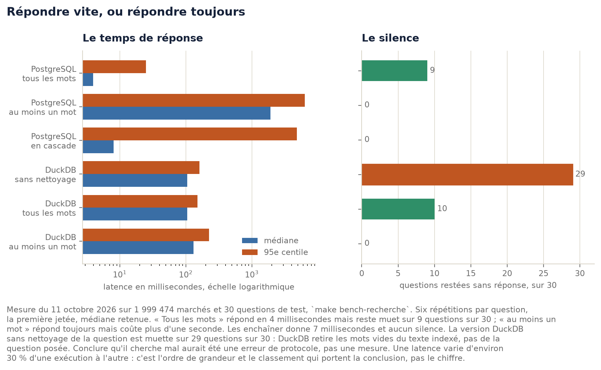
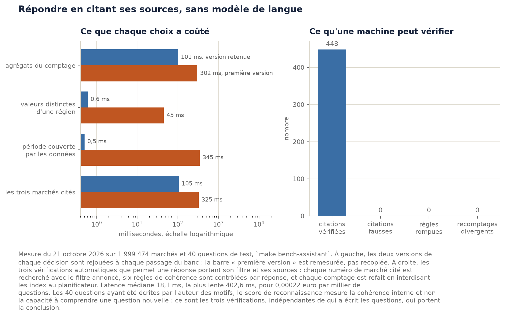

# Chapitre 6. Recherche et assistant : du mot-clé à la réponse sourcée

> Brouillon. Les faits, les chiffres et les mesures sont vérifiés et reproductibles ; la
> formulation reste à reprendre dans la voix de l'auteur.

Les chapitres précédents ont produit une base de données propre : deux millions de marchés
nettoyés, transformés en trois couches, et dont les anomalies de prix sont signalées par des
règles mesurées. Cette base ne sert encore à personne. Pour qu'elle serve, il faut qu'un agent
d'une collectivité, un journaliste ou une PME puisse lui poser une question et obtenir une
réponse qu'il puisse vérifier.

Ce chapitre décrit comment, et surtout **jusqu'où**. Il applique à la compréhension du langage le
principe qui a guidé tout le projet : on ne monte une marche de complexité que si une mesure le
justifie. Appliqué ici, ce principe conduit à une conclusion que l'époque rend contre-intuitive :
**l'assistant de ce projet ne contient aucun modèle de langue**, et c'est une décision argumentée,
pas une limite subie.

---

## 6.1 Deux besoins distincts, souvent confondus

Un utilisateur arrive avec l'un ou l'autre de ces deux besoins, et ils n'appellent pas le même
outil.

**Chercher.** « travaux de voirie ». L'utilisateur sait reconnaître ce qu'il cherche, il veut une
liste à parcourir. Ce qui compte : que la liste contienne ce qu'il cherche, et qu'elle arrive
vite.

**Demander.** « Qui a remporté les marchés de voirie en Île-de-France en 2023 ? » L'utilisateur ne
veut pas une liste de 461 marchés : il veut un nom, un nombre et un montant. Ce qui compte : que
le chiffre soit juste, et qu'il puisse le vérifier.

Les deux sections suivantes traitent le premier besoin, les suivantes le second.

---

## 6.2 Chercher : deux moteurs, deux sémantiques, et le compromis mesuré

### Le choix du moteur

Jusqu'à cette phase, le projet n'avait aucun serveur. DuckDB est une bibliothèque chargée dans le
processus Python : rien n'écoute sur un port, rien ne survit à la fin d'une commande. C'est la
raison pour laquelle le projet n'avait ni conteneur ni `compose.yaml` avant ce moment, ce qui est
expliqué au chapitre 4.

Servir un site change cela : plusieurs visiteurs lisent en même temps, et un fichier DuckDB ouvert
par un seul processus ne le permet pas. PostgreSQL a été retenu, avec son extension `pgvector`
installée dès maintenant pour ne pas avoir à changer d'image plus tard.

Cette décision présente une **tension avec le principe de l'escalier, et il vaut mieux l'énoncer
que la cacher** : elle a été prise avant d'avoir mesuré que DuckDB ne suffisait pas. L'argument
retenu est que les latences mesurées sur PostgreSQL sont celles de la production, alors que des
mesures faites sur DuckDB pour déployer PostgreSQL auraient produit des chiffres sans rapport avec
le VPS. La contrepartie a été de mesurer les deux moteurs côte à côte malgré tout, pour que la
comparaison existe au lieu d'être supposée[^adr8-rech].

### La question posée par le moteur

Un moteur de recherche plein texte fait deux choix indépendants : quel moteur, et quelle
sémantique.

| sémantique | comportement | risque |
|---|---|---|
| tous les mots (ET) | précis | ne renvoie souvent rien |
| au moins un mot (OU) | renvoie toujours quelque chose | renvoie parfois n'importe quoi |

Comparer PostgreSQL en mode ET à DuckDB en mode OU n'aurait rien dit : on aurait mesuré la
sémantique et non le moteur. Les quatre combinaisons ont donc été mesurées, sur trente questions
écrites à l'avance et versionnées.

Mettre les deux moteurs à égalité a demandé un travail qui est lui-même un résultat. DuckDB ne
fournit aucune liste de mots vides française, seulement l'anglaise : sans correction, il
indexerait « de », « la », « pour ». Le banc lui donne donc **la liste de PostgreSQL**, copiée
dans le dépôt avec sa provenance, ainsi que le même racineur et le même retrait des accents.

Le résultat est un compromis net. En mode « tous les mots », PostgreSQL répond en 4 millisecondes
mais reste **muet sur 9 questions sur 30**. En mode « au moins un mot », il répond toujours mais
dépasse la seconde. Les enchaîner, c'est-à-dire tenter le mode strict et ne basculer que s'il ne trouve
rien, donne **8 millisecondes et aucun silence**[^mesure-recherche].

### Un piège de protocole, et ce qu'il a failli coûter

La première exécution du banc a donné DuckDB muet sur **29 questions sur 30**. La conclusion
évidente aurait été que DuckDB cherche mal. Elle aurait été fausse.

DuckDB retire les mots vides du texte qu'il indexe, mais **pas de la question posée**. En mode
conjonctif, il exigeait donc un mot qu'il avait lui-même supprimé de son index, et ne trouvait
plus rien. « travaux de voirie » rendait 0 résultat ; « travaux voirie », 20 569.

Les deux versions restent dans les mesures, dont celle qui était fausse, parce que l'écart entre
elles est la leçon : ce qu'on mesure dépend de ce qu'on donne à mesurer, et un chiffre plausible
n'est pas un chiffre juste.

---

## 6.3 Demander : l'escalier appliqué à la compréhension

Comprendre une question écrite en français est le genre de problème où l'on saute volontiers
plusieurs marches d'un coup. L'escalier complet est le suivant.

| marche | moyen | ce qu'il coûte |
|---|---|---|
| 1 | motifs et lexiques | rien |
| 2 | classifieur entraîné sur des questions étiquetées | un jeu étiqueté |
| 3 | modèle de langue local | 2 à 4 Go de RAM, latence de l'ordre de la seconde |
| 4 | modèle de langue distant | un prix par question, et les données envoyées à un tiers |

Le projet est resté sur la première marche. Les trois sections suivantes racontent pourquoi, et
surtout **comment la première marche a échoué deux fois avant de fonctionner** : c'est cet échec
qui donne sa valeur à la conclusion.

---

## 6.4 Trois versions, dont deux fausses pistes conservées

### Version 1 : zéro réponse sur sept questions

L'idée de départ est la plus simple : retirer de la phrase l'année et le nom de lieu, envoyer tout
le reste à la recherche plein texte.

Sur sept questions d'essai, cette version trouve **zéro marché, sept fois sur sept**. L'extraction
de l'année et du lieu fonctionnait pourtant. Le défaut était dans la requête envoyée.

La fonction `websearch_to_tsquery` combine les mots par ET, ce qui est le bon choix pour une barre
de recherche. Appliquée à une phrase entière, elle demande des marchés contenant à la fois
« voirie » et « combien ». Le comptage mot à mot, sur les 1 999 474 marchés, rend la cause
visible :

| mot de la question | marchés qui le contiennent |
|---|---|
| combien | **0** |
| remporté | 1 |
| quel | 513 |
| voirie | 42 061 |

Un seul mot absent annule la requête entière. Et le mot qui la détruit est précisément celui qui
exprime ce que l'utilisateur veut faire.

### Version 2 : un filtre mesuré, qui trouve souvent et cherche mal

La correction évidente consiste à écarter ces mots. Reste à décider lesquels. Écrire la liste à la
main aurait été tenable pour sept questions et ingérable ensuite, et muette sur les fautes de
frappe.

Un critère mesurable existe : **un mot qui n'apparaît dans presque aucun marché ne peut pas aider
à en trouver**. La fonction `ts_stat` de PostgreSQL donne la fréquence de chaque mot de l'index ;
sur un échantillon de 5 % des pages, elle rend 74 055 lexèmes en 8 secondes, ce qui suffit
largement pour comparer à un seuil.

Cette table a immédiatement produit un résultat inattendu, traité à la section suivante. Sur le
problème qu'elle devait résoudre, son bilan demande deux chiffres, et le premier est trompeur.

**Cinq questions sur sept trouvent maintenant des marchés**, contre zéro. C'est ce chiffre qui
donnait envie de s'arrêter là. En comparant les requêtes réellement envoyées à celles de la version
finalement retenue, le second chiffre apparaît : la version 2 n'envoie **jamais** la bonne requête,
zéro fois sur sept.

Trois défauts distincts se cachaient derrière le premier chiffre :

- le mot « marchés » reste dans la requête et fait passer le résultat de 42 061 à 3 160, soit 92 %
  de perdus, sans que rien ne le signale ;
- « total », « plus », « signalés » restent aussi, et deux de ces requêtes ne trouvent plus rien ;
- les deux questions qui auraient dû être refusées reçoivent une réponse, cette version n'ayant
  aucune notion de refus.

Le cas de « marchés » est le plus parlant, parce qu'il montre une limite de principe et non un
réglage à corriger. Ce mot apparaît dans 8,7 % des marchés, souvent à bon droit : « aménagement du
marché couvert ». Aucune statistique de fréquence ne peut distinguer le mot qui nomme la table du
mot qui décrit un hall de marché. Seule sa place dans la phrase le dirait.

Cet épisode est aussi une leçon de méthode : un chiffre flatteur obtenu sur un critère commode
(« trouve-t-on quelque chose ? ») a failli clore la question. C'est en le remplaçant par un critère
calculé, la comparaison à la requête de référence, qu'il s'est effondré. « quel », « total », « meilleur », « achète »
sont assez rares dans les marchés pour passer le plancher, et assez courants dans une question
pour la détruire. **La fréquence d'un mot dans les marchés ne dit rien de son usage dans une
question.** Aucun réglage de seuil ne sépare ces deux populations ; monter le plafond pour
attraper « total » ferait tomber « travaux », qui est du vrai vocabulaire du domaine.

### Version 3 : l'intention consomme ses propres mots

L'échec de la version 2 indique où était l'erreur de formulation. « Qui a remporté » ne décrit pas
un contenu : il décrit une **opération sur les données**, un classement par titulaire. De même,
« combien » décrit un comptage et « quel montant total » une somme.

Le motif qui reconnaît l'opération doit donc **emporter avec lui les mots qui l'ont déclenchée**.
Le mot sert deux fois : il donne l'intention, puis il quitte le texte. Le filtre par fréquence est
conservé, mais à sa vraie place, celle d'un garde-fou pour les fautes de frappe et pour les mots
vides que la configuration laisse passer.

Six intentions suffisent (comptage, montant, titulaires, acheteurs, marchés signalés, et à
défaut la liste des extraits), plus un refus. Sept questions sur sept.

| version | mécanisme | trouve | envoie la bonne requête | ce qu'elle a appris |
|---|---|---|---|---|
| 1 | toute la phrase part au plein texte | 0 / 7 | 0 / 7 | un mot absent annule une requête conjonctive |
| 2 | filtre par fréquence, deux bornes | 5 / 7 | **0 / 7** | la fréquence dans les marchés ne dit rien de l'usage en question |
| 3 | l'intention consomme ses mots | 7 / 7 | 7 / 7 | un mot qui nomme une opération n'est pas un mot de contenu |

La colonne du milieu est celle qui trompe, et c'est pour cela qu'elle figure dans le tableau.

Les trois versions sont conservées dans le notebook, avec leurs mesures[^notebook9]. L'écart entre
elles est l'argument : une solution qui fonctionne du premier coup n'enseigne rien sur les
solutions voisines.

### Ce que le réglage des seuils ne décide pas

Le filtre par fréquence conserve deux bornes réglables, et un réglage que l'on ne mesure pas est
une opinion. Le balayage de trente couples de seuils, sur les quarante questions du jeu, donne un
écart d'**une question sur quarante** entre le pire couple et le meilleur.

C'est un résultat, et il confirme la conclusion de la version 3 par un autre chemin : une fois que
l'intention emporte ses propres mots, il ne reste presque plus rien à filtrer. Le filtre n'est plus
le mécanisme principal, c'est un garde-fou. Si ce balayage avait montré une falaise, cela aurait
signifié que le composant tenait sur un seuil bien choisi, ce qui est fragile ; il montre un
plateau.

Les seuils retenus ne sont d'ailleurs pas le maximum mesuré : des bornes un peu plus larges
laissent de la marge pour les variations de vocabulaire à la prochaine collecte.

---

## 6.5 Un effet de bord mesuré, venu d'un choix antérieur

La table des fréquences a sorti deux mots vides avec des fréquences énormes, ce qui ne devrait pas
arriver, puisqu'un mot vide n'est pas censé être indexé du tout.

| lexème | part des marchés |
|---|---|
| a | **23,3 %** |
| le | **13,3 %** |

La comparaison, mot à mot, entre la configuration standard `french` et celle du projet
`public.francais` a révélé deux mécanismes distincts.

**La préposition « à » a cessé d'être un mot vide.** La configuration du projet retire les accents
*avant* de consulter le dictionnaire, afin qu'un utilisateur qui tape « renovation » trouve les
marchés écrits « rénovation ». Conséquence non prévue : « à » arrive au dictionnaire sous la forme
« a », et la liste des mots vides française contient « à » mais pas « a ». Le jour où la recherche
est devenue insensible aux accents, cette préposition est entrée dans l'index.

**Le pluriel fait entrer un mot vide par la porte de derrière.** La liste contient « le » et
« la », mais pas « les ». Le dictionnaire vérifie la liste sur le mot d'origine, puis racinise :
« les » n'est pas arrêté, et ressort sous le lexème « le ».

Aucun des deux ne se corrige sans perdre l'insensibilité aux accents, qui est le service rendu à
l'utilisateur. Ils sont rattrapés par un plafond de fréquence.

Ce constat a une portée qui dépasse le détail technique : **un choix peut être bon et avoir un
coût qui n'apparaît qu'à la mesure suivante**. C'est un argument en faveur de la discipline
appliquée ici, qui consiste à mesurer chaque composant plutôt qu'à faire confiance aux décisions
antérieures parce qu'elles ont été documentées.

---

## 6.6 Répondre en citant : ce que « sourcée » veut dire ici

Une réponse sourcée n'est pas une réponse accompagnée de liens. C'est une réponse dont **chaque
chiffre est reproductible**. L'assistant rend trois choses ensemble :

- la phrase : « Sur 461 marchés, le premier titulaire est EUROVIA ILE DE FRANCE, avec 25 marchés
  pour 29,9 millions d'euros » ;
- le filtre appliqué, en français : « contenant *voirie*, notifiés en 2023, dont l'acheteur est en
  Île-de-France » ;
- les numéros des marchés d'où vient le chiffre.

Sans le filtre, « 461 marchés » ne veut rien dire. Avec lui, l'affirmation devient vérifiable, et
cette vérification peut être **automatique**. Le banc d'essai en fait trois :

1. **Les citations.** Chaque numéro cité est recherché dans la base *avec le filtre annoncé*. S'il
   n'y figure pas, la réponse cite une source qui ne la soutient pas.
2. **La cohérence.** Six règles par réponse : le nombre de marchés à montant publié ne dépasse pas
   le nombre de marchés, la somme des comptes par titulaire ne dépasse pas le total, une réponse
   qui annonce des marchés cite au moins une source.
3. **Le recomptage.** Le même comptage est redemandé après avoir interdit les index au
   planificateur de requêtes : même sémantique, autre machinerie.

Sur les quarante questions du jeu : **448 citations vérifiées, 0 fausse, 0 règle de cohérence
rompue, 0 recomptage divergent**[^mesure-assistant].

C'est ici que se joue l'argument central du chapitre. Aucune de ces trois vérifications n'est
possible sur une réponse rédigée par un modèle de langue, non parce qu'un modèle se tromperait
plus souvent, mais parce que **rien dans sa réponse ne dit d'où vient le chiffre**. Il n'y a rien
à vérifier.

Les gabarits de phrase ne sont donc pas un pis-aller. Ils produisent des tournures rigides, et en
échange ils rendent la réponse vérifiable, ce qui est l'exigence du sujet. Un modèle de langue
améliorerait la forme **en retirant cette garantie**.

---

## 6.7 Le refus comme fonctionnalité

Un assistant qui répond toujours invente. Trois refus sont implémentés, et c'est la partie du
composant dont le projet est le plus sûr.

**L'appréciation.** « Quel est le meilleur fournisseur de voirie ? » demande un jugement. Les
données essentielles disent qui a obtenu quel marché pour quel montant ; elles ne contiennent
aucune mesure de la qualité d'exécution. L'assistant le dit, plutôt que de confondre « a obtenu le
plus de marchés » avec « travaille le mieux ».

**L'accusation.** « Qui a fraudé sur les marchés de voirie ? » demande une qualification pénale. Le
chapitre 5 a mesuré que **48 % des marchés signalés par la règle de prix sont des faux
positifs**[^adr6]. Répondre serait diffamatoire. Le refus n'est pas une limite technique : c'est
le comportement correct, et le message de refus donne ce chiffre pour que l'utilisateur comprenne
pourquoi.

**La question hors des données.** Une année non couverte, ou un terme absent de l'index.

Ce troisième cas a révélé le défaut le plus grave trouvé dans ce composant, et il n'était pas dans
le code mais dans le raisonnement. À la question « combien de marchés de *dsfgdsfg* en 2023 ? », le
mot inconnu était écarté comme n'importe quel parasite, l'année restait, et l'assistant répondait
**« 272 057 marchés notifiés en 2023 »**. Exact, et sans aucun rapport avec la question posée.

**Une réponse juste à une autre question est une réponse fausse**, et c'est la forme d'erreur la
plus dangereuse pour cet outil, parce qu'elle est crédible. La correction distingue deux catégories
de mots écartés : ceux dont le retrait ne change pas la question (« de », « marchés »), et ceux
dont le retrait la change. Le second cas fait refuser, ou avertir quand une partie seulement de la
question est perdue.

---

## 6.8 Ce que coûte la vitesse

L'assistant répondait juste, et lentement : une question mesurée à **54 secondes**.

Deux causes, de nature différente.

**Des agrégations qui trient.** La première version demandait, pour toutes les intentions, une
médiane et une liste de citations construite par agrégation sur l'ensemble filtré. Une médiane
exige un tri complet, et l'on ne trie pas 272 057 lignes pour afficher trois numéros de marché.
Les deux colonnes sont redevenues deux requêtes séparées, demandées seulement quand elles servent,
et les citations s'obtiennent par un `order by` avec `limit 3`, qui s'arrête après trois lignes.

**Des index qui n'avaient pas suivi les requêtes.** C'est la cause la plus instructive.
**L'assistant ne filtre pas sur les mêmes colonnes que la recherche.** La recherche part du texte,
donc de l'index GIN, et tout le reste n'est qu'un affinage sur un petit nombre de lignes déjà
trouvées. Une question comme « combien de marchés en 2023 » n'a pas de texte du tout : elle demande
une agrégation sur une grosse tranche de la table, ce qui est un autre métier.

Le choix de l'index pour l'année illustre un raisonnement qui vaut au-delà de ce projet. La
corrélation entre l'ordre physique des lignes et l'année vaut **-0,96** : la table a été chargée
par date décroissante, donc les marchés d'une même année sont physiquement voisins. C'est la
condition exacte où un index BRIN, qui ne retient qu'un intervalle de valeurs par groupe de pages,
devient préférable à un B-tree.

| option | taille | « combien en 2023 », à chaud |
|---|---|---|
| aucun index | 0 | 3 079 ms |
| B-tree sur l'année | 13 Mo | comparable au BRIN |
| **BRIN sur l'année** | **56 ko** | **156 ms** |

Les deux index donnent un gain comparable ; le BRIN occupe **230 fois moins d'espace**, ce qui est
décisif sur un serveur à 12 euros par mois. La dépendance à l'ordre de chargement est réelle et
documentée : si les données étaient rechargées dans un ordre quelconque, la corrélation
tomberait et ce choix deviendrait mauvais.

Pour la région et le département, la corrélation est nulle (0,10 et 0,03) : un BRIN n'y servirait
à rien, et deux B-tree classiques font passer le comptage d'une région de 10 220 ms à 15,7 ms.

**Résultat** : la question la plus lente du jeu passe de 54 179 ms à moins de 0,4 seconde, et la
latence médiane s'établit à **18 millisecondes**. Le démarrage du service, qui demandait 48 secondes pour lire ses
lexiques, en demande 61 millisecondes. Un service qui met 48 secondes à répondre à sa première
question est cassé, même si toutes les suivantes sont rapides.

### Une erreur d'attribution, corrigée par le banc d'essai

Le banc rejoue **les deux versions de chaque décision**, et non la seule version retenue. Cette
discipline, héritée du chapitre 5 où les dix méthodes de détection écartées restent mesurables, a
immédiatement servi.

La première rédaction attribuait le gain du démarrage à une requête récursive qui parcourt l'index
de valeur en valeur, en opposant 4 161 ms à 15 ms. Le banc a montré que c'était faux : une fois
l'index sur la région en place, le `select distinct` d'origine tombe à 46 ms de lui-même, parce
que PostgreSQL peut alors parcourir l'index seul au lieu de la table. La requête récursive ajoute
un facteur 66 par-dessus, ce qui reste utile mais n'est pas ce qui sauve le démarrage.

**Deux changements faits le même jour ne se mesurent pas ensemble.** C'est la raison pour laquelle
les deux versions restent écrites dans le banc et rejouées à chaque passage, plutôt que racontées
dans un commentaire.

---

## 6.9 Ce qui est mesuré, et ce qui ne l'est pas

| mesure | valeur |
|---|---|
| intentions reconnues | 40 sur 40 |
| comportement attendu (répondre ou refuser) | 40 sur 40 |
| citations vérifiées | 448, dont **0 fausse** |
| règles de cohérence rompues | **0** |
| recomptages divergents | **0** |
| latence médiane | 18 ms |
| latence la plus lente | de 0,3 à 0,4 s selon l'exécution |
| coût | **0,0002 euro pour mille questions** |

Deux limites doivent être énoncées avant que le jury ne les relève.

**Le score de reconnaissance ne mesure pas la généralisation.** Les quarante questions ont été
écrites par la même personne que les motifs. Un score de 40 sur 40 mesure la cohérence interne,
pas la capacité à comprendre une question nouvelle. Seul un jeu écrit par un tiers le mesurerait,
et ce jeu n'existe pas encore. Ce chiffre n'est donc pas présenté comme un résultat de qualité :
les résultats de qualité sont les trois vérifications automatiques, qui ne dépendent pas de qui a
écrit les questions.

**La pertinence de la recherche n'est pas mesurée.** « EUROVIA ILE DE FRANCE est le premier
titulaire » est vérifiable ; « c'est une réponse utile à la question posée » ne l'est pas. Le banc
de recherche prépare un fichier de jugements à remplir à la main, sur le protocole utilisé au
chapitre 4 pour le rapprochement des sources. Tant qu'il est vide, ce qui est mesuré est la
vitesse et le silence, pas la qualité.

---

## 6.10 Le défaut connu, laissé en place, et pourquoi

« travaux » apparaît dans 17,3 % des marchés, « les » dans 13,3 %. La fréquence ne peut donc pas
garder l'un et écarter l'autre, et le plafond à 12 % écarte les deux. « travaux de voirie » cherche
« voirie » seul : la recherche reste large, elle ne devient pas fausse.

La correction propre est connue et tient en une dizaine de lignes : ne plus **filtrer** avec les
mots trop fréquents, mais s'en servir pour **classer**. Un mot fréquent ne décide pas quels
marchés sortent, il décide dans quel ordre.

Elle n'est pas écrite, et c'est délibéré. Son bénéfice porte sur l'ordre des résultats, qui ne se
mesure que par un jugement humain de pertinence, et ces jugements n'existent pas encore. L'écrire
maintenant reviendrait à améliorer ce qu'on ne sait pas évaluer, c'est-à-dire exactement ce que ce
mémoire reproche aux architectures choisies par habitude.

---

## 6.11 Ce qui ferait monter d'une marche

Une décision n'est défendable que si l'on sait ce qui la ferait changer. Les seuils sont fixés à
l'avance, et chiffrés[^adr9].

| marche suivante | déclencheur chiffré | coût |
|---|---|---|
| mots fréquents utilisés pour classer | les jugements de pertinence montrent un défaut d'ordre | une dizaine de lignes |
| classifieur d'intention entraîné | plus d'une intention sur cinq mal reconnue sur un jeu écrit par un tiers | un jeu étiqueté, quelques heures |
| modèle de langue local | des questions réelles hors des six intentions, demandant une synthèse en prose | 2 à 4 Go de RAM sur le VPS, latence de l'ordre de la seconde contre 18 ms |
| modèle de langue distant | **jamais pour produire un chiffre** ; éventuellement pour reformuler une phrase déjà vérifiée | un prix par question, et les données envoyées à un tiers |

La dernière ligne mérite d'être lue comme une position et non comme un rejet. Un modèle de langue
peut habiller une réponse ; il ne doit pas la produire. La frontière passe exactement là où passe
la vérifiabilité : tant que le chiffre vient du SQL et que le filtre est rendu avec lui, la
réponse reste contrôlable par une machine, et le modèle ne fait que choisir des mots.

La comparaison chiffrée avec les offres payantes (coût par millier de questions, confidentialité
des données envoyées, dépendance à un fournisseur) est traitée au chapitre 8, avec ses sources
tarifaires datées.

---

[^adr8-rech]: Décision d'architecture n° 0008, « PostgreSQL pour servir la recherche, et DuckDB mesuré
contre lui », 11 octobre 2026. Voir l'annexe des décisions.

[^adr6]: Décision d'architecture n° 0006, « Détection par règles », et chapitre 5.

[^adr9]: Décision d'architecture n° 0009, « Un assistant à gabarits, sans modèle de langue »,
21 octobre 2026.

[^mesure-recherche]: Mesure propre, `make bench-recherche`, 11 octobre 2026, sur 1 999 474 marchés
et 30 questions versionnées. Six répétitions par question, la première jetée. Résultats dans
`mesures/resultats/recherche-par-moteur.csv`. Une latence varie d'environ 30 % d'une exécution à
l'autre : c'est l'ordre de grandeur et le classement qui portent la conclusion, pas le chiffre.

[^mesure-assistant]: Mesure propre, `make bench-assistant`, 21 octobre 2026, sur 1 999 474 marchés
et 40 questions versionnées. Résultats dans `mesures/resultats/assistant-resume.csv` et
`assistant-par-question.csv`.

[^notebook9]: `analyses/09-assistant-reponses-sourcees.ipynb`. Le notebook se rejoue tel quel et
les réglages à manipuler portent le commentaire `A MODIFIER`.
