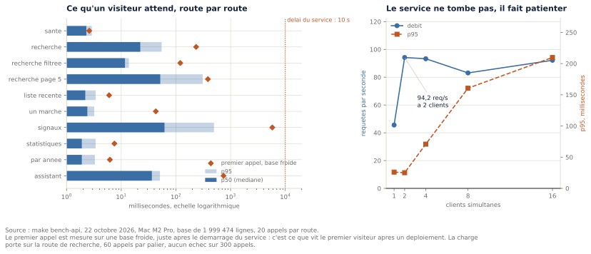

# 10. Mise en production et sécurité

> État : les sections 10.1 et 10.2 sont rédigées (phase 7). Les sections 10.3 à 10.6, qui portent
> sur le VPS, les conteneurs, la supervision et les sauvegardes, seront écrites en phase 9.

## 10.1 Servir les données : l'API

Jusqu'ici, tout ce que ce mémoire décrit n'existait que sous la forme de scripts lancés à la main
sur un ordinateur portable. Deux millions de marchés nettoyés, une recherche en texte intégral,
des règles de détection et un assistant qui cite ses sources : rien de tout cela n'était
accessible à qui que ce soit d'autre. Cette section décrit le passage d'un traitement à un
service, et surtout ce que ce passage a appris.

### 10.1.1 Ce qu'un service change par rapport à un script

Un script a le droit d'être lent. Il tourne une fois, on attend, on obtient un fichier. Un service
n'a pas ce droit : quelqu'un attend devant un écran, et il n'a aucune idée de ce qui se passe.
Cette différence n'est pas une question de degré, elle change les critères de conception.

Trois contraintes apparaissent d'un coup. D'abord, **le temps devient une exigence** et non une
observation : une requête qui prend dix secondes n'est pas une requête lente, c'est une page qui
ne s'affiche pas. Ensuite, **les entrées viennent de l'extérieur** : un script reçoit ses
paramètres de celui qui l'écrit, un service reçoit ce qu'un inconnu a tapé, y compris ce qu'il a
tapé pour voir ce qui casserait. Enfin, **les erreurs doivent être racontées à quelqu'un** : un
script peut s'arrêter avec une trace d'exécution, un service doit répondre quelque chose, et ce
quelque chose ne doit révéler ni le texte de ses requêtes ni le nom de son serveur.

L'API construite ici expose sept routes : l'état du service, la recherche de marchés, le détail
d'un marché, les signaux de détection, deux jeux de comptages et l'assistant. Le choix du cadre
technique, FastAPI plutôt que Flask, Django REST Framework ou Litestar, est détaillé dans
l'ADR 0011 ; il tient en une phrase : le projet était déjà entièrement annoté et vérifié par un
analyseur de types en mode strict, et FastAPI réutilise ces annotations pour valider les entrées
et produire sa documentation, de sorte que le travail de typage sert deux fois.

Ce choix n'est pas le sujet intéressant. Le sujet intéressant est ce qui s'est passé quand on a
mesuré.

### 10.1.2 Quatre défauts qu'aucun test ne pouvait trouver

À la fin de la phase 6, le dépôt comptait 195 tests, tous verts, et une chaîne d'intégration
continue qui vérifiait le style, les types, les secrets et le comportement. La première version de
l'API passait l'ensemble sans une seule erreur. Elle était pourtant inutilisable, et le banc de
mesure `make bench-api` l'a montré en moins d'une minute.

La raison est simple et vaut d'être énoncée : **aucun test ne mesure une durée**. Un test vérifie
qu'une fonction rend le bon résultat, pas qu'elle le rend assez vite. Les quatre défauts ci-dessous
produisaient tous des résultats justes.

| Ce qui était écrit | Ce que la mesure a donné | Ce qui a changé |
|---|---|---|
| trier la liste récente par `date_notification desc nulls last` | **28 636 ms** : PostgreSQL renonce à l'index et parcourt les deux millions de lignes | `order by date_notification desc, id desc`, soit **30 ms** |
| classer tous les marchés qui répondent à la recherche | **9 656 ms** sur le mot « travaux », abandonnée par la base | classement limité à un nombre fixe de candidats |
| calculer les comptages de la page d'accueil à chaque visite | entre **10 726 ms** et **61 519 ms** selon l'état des caches | table remplie au chargement, lue en **0,5 ms** |
| calculer la série par année à chaque visite | **655 ms** de médiane, **2 365 ms** au 95e centile | seconde table remplie au chargement, **2 ms** |

Le premier cas mérite d'être regardé de près, parce que le défaut était une **précaution**. La
mention `nulls last` servait à placer en fin de liste les marchés dont la date de notification
serait absente. L'intention est raisonnable. Deux faits la rendent absurde. Le premier est qu'un
index déclaré sur `date_notification desc` place par convention les valeurs absentes en tête, de
sorte que demander l'ordre inverse revient à demander un ordre que l'index ne connaît pas : le
moteur abandonne l'index et trie deux millions de lignes. Le second est qu'il n'existe **aucune**
ligne sans date de notification, sur 1 999 474. Une protection qui ne protégeait de rien a coûté
un facteur 965.

C'est la forme la plus commune du problème : non pas une erreur, mais une habitude défensive dont
personne ne mesure le prix. Elle serait restée invisible aussi longtemps que la table serait
restée petite, et elle n'aurait jamais fait échouer un test.

### 10.1.3 Mesurer à froid, et pourquoi cela a changé une décision

Le troisième défaut a eu une suite instructive. Après avoir limité le classement de la recherche à
20 000 candidats, les mesures étaient excellentes : 57 millisecondes de médiane. La décision
semblait close.

Le banc l'a rouverte au lancement suivant. La toute première recherche après le démarrage du
service renvoyait une erreur. En remesurant, en redémarrant la base avant chaque essai pour vider
sa mémoire partagée :

| Candidats classés | Base froide | À chaud |
|---|---|---|
| 20 000 | **7 219 ms** | 57 ms |
| 5 000 | 436 ms | 116 ms |
| 1 000 | 42 ms | 101 ms |

Un facteur 128 entre froid et chaud. La cause est lisible : classer suppose de lire, pour chaque
candidat, le vecteur de mots du marché, que PostgreSQL stocke à part parce qu'il pèse plusieurs
kilo-octets. Aller chercher 20 000 de ces vecteurs sur un disque dont rien n'est en mémoire coûte
exactement ce que la mesure dit.

Ce qui compte ici n'est pas le chiffre mais la leçon de méthode : **mesurer seulement à chaud
revient à valider un service qui échoue à chaque déploiement**, c'est-à-dire précisément au moment
d'une démonstration. Le banc mesure donc désormais le premier appel séparément, et ne le jette
pas. C'est la barre rouge de la figure 24.

Le panneau de droite dit l'autre moitié de l'histoire. Le débit plafonne entre 95 et 111 requêtes
par seconde selon l'exécution, dès deux clients simultanés, et au-delà la latence croît
proportionnellement au nombre de clients, sans aucun échec sur 300 appels. C'est le comportement attendu d'une file d'attente : le
service ne s'effondre pas, il fait patienter. La limite vient de la réserve de connexions, fixée à
quatre volontairement, parce que chaque connexion PostgreSQL est un processus serveur et que la
machine de production sera petite.

### 10.1.4 Ce que l'optimisation a coûté, et pourquoi il faut l'écrire

Limiter le classement à 5 000 candidats n'est pas gratuit, et c'est le point le plus important de
cette section. Au-delà de ce plafond, les dix marchés affichés ne sont plus les dix meilleurs : ce
sont les mieux classés **parmi les 5 000 premiers que l'index rend**. Le banc compare les deux
listes :

| Marchés qui répondent | Marchés communs sur dix |
|---|---|
| 437 | 10 |
| 1 162 | 10 |
| 5 489 | 8 |
| 13 482 | 5 |
| 20 477 | 3 |
| 101 818 et au-delà | 0 |

Sous le plafond, l'ordre est exact. Au-dessus, il peut être entièrement différent, y compris pour
une question ordinaire de trois mots. Deux sur dix n'est pas une nuance d'ordre : ce sont huit
autres marchés.

Trois choses doivent être dites franchement à ce sujet.

La première est que l'alternative mesurée n'était pas « un classement exact un peu plus lent »,
mais une page qui ne s'affiche pas. Une page absente n'a pas d'ordre du tout.

La deuxième est que les marchés rendus ne sont pas quelconques. La table étant écrite par date
décroissante, les 5 000 premiers candidats sont en pratique les plus récents. Pour une question
d'un seul mot très courant, « les plus récents qui contiennent ce mot » est même une réponse plus
utile que « les mieux classés », le score de proximité ne distinguant presque rien quand il n'y a
qu'un mot à situer. Mais il faut noter que cette propriété repose sur la façon dont le chargeur
écrit les lignes, et non sur une garantie du modèle relationnel : c'est une dépendance réelle,
mesurée par la corrélation de -0,96 entre l'ordre physique et l'année, et vérifiée par un test.

La troisième n'est pas négociable : **il faut le dire**. Chaque réponse de recherche porte un
champ `classement_approche` et le nombre de candidats réellement classés, et l'interface l'écrit à
l'écran. Une approximation annoncée est une limite connue ; une approximation silencieuse est un
mensonge sur la donnée. C'est la même exigence que celle qui gouverne l'assistant au chapitre 9 :
un résultat doit porter de quoi le vérifier.

### 10.1.5 Sécurité : ce qui est refusé par construction

Les mesures occupent l'essentiel de cette section parce que ce sont elles qui ont changé le code.
La sécurité, elle, n'a rien changé après coup : elle est posée dès l'écriture, et c'est précisément
ce qu'on attend d'elle.

Quatre défenses méritent d'être décrites, parce qu'elles ne relèvent pas de la bonne volonté mais
de la structure.

**Aucune valeur fournie par un visiteur n'entre dans le texte d'une requête.** Seule la structure
de la requête est composée, à partir de fragments écrits dans le projet, et les valeurs restent des
paramètres. Ce n'est pas une discipline mais une propriété vérifiable : un test parcourt les
fichiers de l'API et échoue si une ligne mêle un mot-clé SQL et une chaîne formatée.

**Les connexions sont ouvertes en lecture seule.** Une route qui tenterait une écriture, par erreur
ou par détournement, serait refusée par la base elle-même. L'API ne peut pas modifier les données
qu'elle sert, quelle que soit la requête reçue.

**Chaque requête est abandonnée au-delà de dix secondes.** Sans ce plafond, une requête
pathologique garde indéfiniment une connexion et un fil d'exécution : le service devient
indisponible sans être tombé, ce qui est le mode de panne le plus difficile à diagnostiquer. Ce
même plafond est ce qui a révélé trois des quatre défauts de la section 10.1.2, en transformant une
lenteur en erreur visible.

**Les messages d'erreur de la base ne sortent jamais.** Un message de l'interface PostgreSQL
contient le texte de la requête, parfois l'hôte et le nom de l'utilisateur. Il part dans le journal
du serveur, et le visiteur reçoit un code et une phrase.

S'y ajoutent les bornes sur chaque entrée, toutes testées une par une, et les en-têtes de sécurité
posés par le service lui-même plutôt que par le serveur placé devant lui, pour qu'il reste sain même
testé en direct.

Deux absences sont volontaires et seront traitées en phase 9. Il n'y a **pas de limitation de
débit** dans le code : un compteur en mémoire serait remis à zéro à chaque redémarrage, compterait
faux dès qu'il y a plus d'un processus, et devrait faire confiance à un en-tête que n'importe qui
peut écrire. Le filtrage par adresse appartient à celui qui voit la vraie adresse, c'est-à-dire au
serveur frontal. Et il n'y a **pas d'authentification** sur ces routes, parce que les données
servies sont publiques par nature ; l'espace d'administration, lui, en aura une, et c'est la raison
pour laquelle il est construit comme un ensemble de routes séparées.

## 10.2 Montrer les données : l'interface

Une API sert un programme. La démonstration attendue s'adresse à un jury, puis à un visiteur
ordinaire, et aucun des deux ne lit du JSON. Cette section décrit l'interface, les trois
contraintes qui ont décidé de sa forme, et ce que sa construction a révélé sur l'API qu'elle
utilise.

### 10.2.1 Trois contraintes, et une forme qui en découle

Le choix d'une technologie d'interface est généralement présenté comme une préférence. Ici, trois
contraintes antérieures le déterminent presque entièrement.

**Le déploiement.** Le serveur de production est une machine virtuelle de petite taille. Tout ce
qui exige un environnement Node.js, une étape de compilation, un second artefact ou un second
conteneur est un coût d'exploitation permanent, pour un site de six pages.

**La démonstration.** Elle peut avoir lieu hors ligne. Un site qui charge sa bibliothèque
d'interface depuis un réseau de diffusion de contenu est un site qui peut être blanc le jour de la
soutenance ; un site qui n'affiche rien sans JavaScript l'est également.

**La vérifiabilité.** Le chapitre 2 a montré que ces données sont lacunaires et piégeuses. Une
interface qui afficherait des chiffres sans leur dénominateur, leur date de calcul et leur unité de
comptage trahirait tout ce qui précède.

De ces trois contraintes découle une forme ancienne, redevenue courante : **les pages sont
fabriquées par le serveur**, avec un moteur de gabarits, et une bibliothèque de quatorze
kilo-octets compressés remplace le rechargement complet de la page par le remplacement du seul
fragment qui change.

| Option | Avantage | Limite | Verdict |
|---|---|---|---|
| **Gabarits rendus par le serveur + htmx** | un service, aucune compilation, aucun Node.js en production, le HTML arrive rempli | un gabarit de plus par fragment | **retenu** |
| Application React ou Vue séparée | l'état du formulaire est tenu par le navigateur | une chaîne de compilation, un second artefact à déployer et à sécuriser, et une API publique à versionner pour son propre usage | écarté |
| Gabarits seuls, sans rechargement partiel | le plus simple possible | chaque filtre recharge toute la page : 11,7 ko au lieu de 7,9 ko mesurés | écarté |
| La bibliothèque chargée depuis un CDN | rien à versionner | la démonstration dépend du réseau de la salle, et la politique de sécurité doit ouvrir un domaine tiers | écarté |

La bibliothèque retenue est donc versionnée dans le dépôt, et le site fonctionne sans aucun accès
réseau.

**L'échelle à laquelle cette réponse changerait** mérite d'être nommée, car elle n'est pas
lointaine : dès qu'une page devrait tenir un état complexe côté navigateur, un formulaire à
plusieurs étapes ou une carte interactive, un cadre JavaScript reprendrait l'avantage. Afficher une
liste et des filtres n'en demande pas.

### 10.2.2 Dégradation progressive, et pourquoi elle est mesurée

Les formulaires du site sont de véritables formulaires HTML, dont l'attribut `action` mène à une
page complète. La bibliothèque d'interface ne fait qu'intercepter l'envoi pour remplacer un
fragment au lieu de recharger la page. Si elle ne se charge pas, pour quelque raison que ce soit,
le site continue de fonctionner, plus lentement.

Cette propriété est facile à affirmer et facile à perdre. Le banc de mesure la vérifie donc
explicitement : chaque page est demandée sans l'en-tête que la bibliothèque ajoute à ses appels,
c'est-à-dire exactement comme le ferait un navigateur dont le JavaScript est désactivé, et le
contenu attendu doit être présent dans le HTML reçu. Dix pages sur dix au 22 octobre 2026.

La même route rend donc deux choses : la page entière, ou le seul fragment qui change, selon
l'en-tête reçu. Ce choix a trois conséquences utiles. L'adresse reste unique, donc partageable et
citable dans ce mémoire. Le bouton « retour » du navigateur fonctionne sans code supplémentaire.
Et seul le fragment transite lors d'un changement de filtre.

| Page | Page entière | Fragment | Économie |
|---|---|---|---|
| recherche par texte | 11,7 ko | 7,9 ko | 32 % |
| recherche filtrée | 11,0 ko | 7,1 ko | 35 % |
| marchés à examiner | 8,2 ko | 5,2 ko | 35 % |
| question à l'assistant | 5,5 ko | 1,6 ko | 71 % |

*Source : `make bench-site`, 22 octobre 2026. Figure 25.*

Ces chiffres justifient la bibliothèque sans l'exagérer : l'économie est réelle, elle n'est pas
spectaculaire, et elle n'aurait pas suffi à elle seule. Ce qui la rend intéressante est qu'elle ne
coûte ni compilation, ni dépendance distante, ni perte de fonctionnement sans JavaScript.

### 10.2.3 Le poids d'une page, et le refus d'optimiser sans mesure

La latence du serveur ne dit pas ce qu'attend un lecteur. Une page qui se calcule en vingt
millisecondes et pèse quatre cents kilo-octets est lente sur une connexion mobile. Le banc mesure
donc le poids servi, compressé et non compressé.

| Page | Poids | Compressé | Attente à 2 Mbit/s |
|---|---|---|---|
| fiche d'un marché | 4,4 ko | 1,9 ko | 8 ms |
| question à l'assistant | 5,5 ko | 2,1 ko | 8 ms |
| marchés à examiner | 8,2 ko | 1,9 ko | 8 ms |
| accueil | 10,3 ko | 3,0 ko | 12 ms |
| recherche large | 12,0 ko | 5,5 ko | 22 ms |

*Source : `make bench-site`, 22 octobre 2026.*

S'y ajoutent soixante-cinq kilo-octets de feuille de style, de bibliothèque et d'icône,
téléchargés une seule fois puis conservés par le navigateur.

La conclusion est qu'il n'y a **rien à optimiser**, et c'est une conclusion qui a de la valeur :
sans mesure, l'optimisation du poids d'une page est un réflexe que l'on applique par habitude, et
qui consomme du temps au détriment de ce qui compte. Ici, ce qui compte est la requête à la base,
pas l'octet transmis.

### 10.2.4 Ce que l'interface a révélé dans l'API

C'est le résultat le plus utile de cette phase, et il n'était pas prévu. L'API décrite en 10.1
avait été publiée la veille, avec 239 tests verts et un banc de mesure qui avait déjà corrigé
quatre défauts. **Écrire des pages qui l'utilisent en a révélé trois de plus**, en trois heures.

| Défaut | Ce qui le cachait | Ce qui l'a révélé |
|---|---|---|
| Une route annonçait des modèles et rendait des dictionnaires, sous un commentaire désactivant la vérification de types | Le cadre convertissait au moment de sérialiser : la réponse HTTP était juste | Une page appelant la fonction directement |
| Toute question sur les titulaires ou les acheteurs faisait répondre 500 | Le type d'un champ refusait une liste ; un banc n'appelle pas le modèle, l'autre n'envoyait qu'une seule question | Une page posant une autre question |
| La liste des marchés signalés ne permettait pas de savoir s'il existait une page suivante | Personne n'avait eu à paginer | Un lien « page suivante » à construire |

Le point commun de ces trois défauts est qu'ils étaient invisibles depuis l'intérieur. Une
interface de programmation dont le seul appelant est celui qui l'a écrite n'est pas réellement
appelée : elle n'est utilisée que selon les usages que son auteur avait en tête en l'écrivant.

Le premier mérite d'être détaillé, car sa forme est très répandue. La route rendait les lignes
brutes de la base en annonçant un type de modèle, avec un commentaire demandant au vérificateur de
types de se taire. Rien n'échouait, parce que le cadre convertissait au moment de produire la
réponse HTTP. L'annotation était fausse depuis le début, et la fausseté est restée sans
conséquence jusqu'à ce qu'un second appelant utilise la fonction autrement. **Un commentaire qui
désactive une vérification ne masque pas un détail technique : il masque une affirmation fausse,
qui attend son second appelant.**

Le deuxième illustre une limite des bancs de mesure eux-mêmes. Deux existaient : l'un vérifie les
quarante questions de l'assistant, leurs chiffres et leurs 448 citations, mais appelle la
bibliothèque sans passer par le modèle de réponse ; l'autre passe par le modèle, mais n'envoyait
qu'une question. Chacun couvrait exactement ce que l'autre laissait de côté, et neuf questions sur
quarante produisaient une erreur depuis la mise en service. La correction porte autant sur le banc
que sur le code : il envoie désormais une question par intention.

### 10.2.5 Le premier visiteur, et un coût qui change de place

La section 10.1.3 montrait déjà qu'une mesure à chaud ne dit rien du premier accès. La
construction de l'interface a poussé ce constat plus loin, parce qu'elle a produit la situation
réelle : ouvrir une page sur une machine qui vient de démarrer.

La première question posée à l'assistant a dépassé les dix secondes que le service s'accorde, et
la page a affiché une erreur. La même question, posée ensuite, répond en 86 millisecondes. Rien
n'était défectueux : la base n'avait aucune de ses pages en mémoire, et le premier visiteur payait
le remplissage des caches pour tous les suivants. Le mécanisme est même circulaire, et c'est ce qui
le rend sérieux : le délai maximal que le service s'impose interrompt la requête **avant qu'elle
n'aboutisse**, donc rien n'est mis en cache, donc la requête suivante repart de zéro.

Le service exécute donc à son démarrage les requêtes les plus coûteuses. Trois versions ont été
mesurées, et les deux premières étaient fausses.

| Approche | Démarrage | Première recherche | Première page de signalements |
|---|---|---|---|
| Aucun préchauffage | 0,9 s | 794 à 1 766 ms | 1 199 à 2 812 ms |
| Requêtes écrites à la main, ressemblant à celles du service | 2,1 s | 135 ms | 1 379 ms |
| Table entière chargée en mémoire | 22,1 s | 647 ms | non mesurée |
| **Les requêtes réelles du service** | **11 à 27 s** | **95 à 180 ms** | **164 ms** |

*Source : `make bench-site`, 22 octobre 2026, base froide après redémarrage complet.*

La deuxième ligne contient l'enseignement principal. Des requêtes qui *ressemblent* à celles du
service ne préchauffent pas le service : la mise en mémoire ne concerne que les pages réellement
lues, et une recherche sur un mot lit trois mille pages parmi cent soixante-dix-sept mille. Le
préchauffage est donc construit à partir des requêtes du service lui-même, et l'assistant est
préchauffé en lui posant réellement les questions que le site propose en exemple.

La troisième ligne est l'option que l'on adopte par réflexe, et la mesure l'a écartée : charger la
table entière coûte vingt-deux secondes de démarrage pour un gain partiel, la mémoire allouée au
cache de la base valant la moitié de la taille de la table.

Le coût n'a pas disparu, il a changé de place, et il ne diminue pas : sur une base réellement
froide, le démarrage atteint vingt-sept secondes, ce qui est exactement ce que le premier
visiteur payait auparavant. Le préchauffage ne crée pas cette dépense, il la rend visible et la
déplace là où personne n'attend. Le service ne se déclare prêt qu'une fois chaud, ce qui est le
sens que l'on veut donner au mot : répondre à un test de vie en étant incapable de servir une
page serait un mensonge sur son état. La conséquence pratique est à retenir pour le chapitre
suivant : le délai de grâce du contrôle de santé du conteneur devra être généreux, faute de quoi
le superviseur redémarrerait en boucle un service en train de démarrer normalement.

Une honnêteté de méthode pour finir. Cette mesure est **très instable** : entre deux exécutions, le
même premier appel varie de 1 281 à 7 302 millisecondes, selon ce que le système d'exploitation
conserve du disque de la machine virtuelle. Redémarrer la machine virtuelle ne suffit pas à
refroidir réellement. Les valeurs publiées sont donc données sous forme d'intervalles, ce qui est
moins élégant qu'un nombre unique et plus proche de ce qui a été observé.

### 10.2.6 Afficher ce que les données ne disent pas

Le chapitre 2 a établi que ces données sont incomplètes et ambiguës. Une interface qui l'ignorerait
produirait des chiffres faux avec une confiance parfaite. Six mentions sont donc portées à l'écran,
et chacune correspond à une erreur que le site aurait commise sans elle.

**Le total des montants.** La page d'accueil devait afficher une somme. Le projet documentait
depuis la phase 2 qu'un marché attribué à un groupement d'entreprises occupe une ligne par
titulaire, avec mesure et figure à l'appui, mais uniquement pour les *comptages*. Personne n'avait
examiné l'effet sur les *montants*, alors que le montant publié sur chaque ligne d'un groupement
est le plus souvent celui du marché entier, répété.

| Façon de compter | Total | Coût de calcul |
|---|---|---|
| Somme des lignes | 1 500,9 milliards d'euros | 2 s |
| **Une fois chaque couple (marché, montant)** | **1 098,2 milliards d'euros** | 13 s |
| Montant le plus élevé de chaque marché | 1 097,9 milliards d'euros | 25 s |

*Source : base chargée au 22 octobre 2026, 1 999 474 attributions.*

L'addition naïve surestime de **402,7 milliards d'euros, soit 36,7 %**. Les deux règles
défendables, elles, diffèrent de 0,03 %. Autrement dit : le choix entre elles ne change rien, et le
choix de dédoublonner ou non change le total de plus d'un tiers. La page affiche le total
dédoublonné, l'addition naïve à côté, et l'écart en pourcentage.

Ce chiffre ne venait d'aucun défaut de code. Il venait d'une addition exacte, sur des données
documentées, appliquée à la mauvaise unité de comptage. C'est la forme d'erreur la plus difficile à
détecter, parce que rien ne la signale.

**Les cinq autres mentions**, plus brèves : la part d'entreprises de petite taille est rapportée
aux seules attributions dont la catégorie du titulaire est connue, et la page indique combien
manquent ; les comptages portent leur date de calcul, car un chiffre sans sa date ne dit pas s'il
est périmé ; la page des marchés atypiques s'intitule « à examiner » et rappelle la concordance de
69,3 % mesurée hors échantillon ; la liste de résultats annonce « classement approché » dès que le
plafond de candidats est atteint, avec l'indication de ce qu'il faut faire pour le rendre exact ;
et le pied de chaque page cite l'adresse de l'interface de programmation qui l'a produite, car
« vérifiable » signifie que l'on peut obtenir la même chose sans ce site.

### 10.2.7 Sécurité : une politique sans exception, vérifiée dans un navigateur

La politique de contenu du site interdit tout par défaut, puis autorise uniquement ce qui est
nécessaire, et uniquement depuis le site lui-même. Aucun domaine tiers n'y figure, puisque aucun
fichier n'est chargé depuis un tiers. Surtout, elle n'autorise **ni le script ni le style en
ligne**, ce qui est l'exception que presque tous les sites finissent par s'accorder.

Cette rigueur a un coût visible dans le code. Le diagramme de la page d'accueil aurait pu être une
série de barres dimensionnées par un attribut de style ; il a fallu en faire une image vectorielle
dont la géométrie passe par des attributs, calculés dans le code de la page. C'est quelques lignes
supplémentaires, contre l'autorisation permanente d'appliquer un style arbitraire injecté dans la
page.

Une anecdote illustre pourquoi cette vérification ne peut pas être seulement théorique. Tous les
tests passaient, le banc passait, la page s'affichait correctement. L'ouverture de la page dans un
navigateur a révélé une violation dans la console : la bibliothèque d'interface insère sa propre
feuille de style au chargement, pour des indicateurs d'attente dont le site n'avait pas besoin. La
correction consiste à la configurer par une balise de métadonnées plutôt qu'en JavaScript, ce que
la politique interdirait précisément. **Une politique de sécurité ne se vérifie pas en la lisant,
elle se vérifie en la faisant appliquer.** Le banc relit désormais les en-têtes réellement servis,
mais c'est l'ouverture d'un onglet qui a trouvé celle-là.

S'y ajoutent l'échappement systématique de tout texte provenant des données, vérifié par un test
sur un objet de marché contenant une balise de script ; des pages d'erreur en HTML et non en JSON,
le choix se faisant sur l'adresse demandée et non sur un en-tête que les navigateurs remplissent de
façon inexploitable ; et l'absence totale d'authentification, assumée, parce que les données
servies sont publiques par nature. L'espace d'administration, qui n'est pas dans ce périmètre, en
aura une, et c'est la raison pour laquelle il est construit séparément.

### 10.2.8 Une adresse pour les pages, une autre pour les données

Une page HTML et une réponse JSON ne peuvent pas répondre à la même adresse. L'interface de
programmation occupait les adresses les plus naturelles, et les pages en avaient besoin.

Trois options existaient : renommer les pages pour éviter les collisions, choisir le format selon
l'en-tête déclarant ce que l'appelant accepte, ou donner un préfixe à l'interface de
programmation. La deuxième est élégante et fausse en pratique : un navigateur déclare accepter à
peu près tout, et le visiteur recevrait du JSON une fois sur deux. La première produirait deux
jeux de noms voisins, et une collision dès la page suivante.

L'interface de programmation a donc pris un préfixe. Les adresses publiées la veille ont changé, ce
qui n'est jamais agréable, mais elle n'avait aucun consommateur extérieur : l'opération a coûté une
heure de mise à jour de la documentation et des mesures. Reportée de six mois, elle aurait exigé
des redirections à maintenir indéfiniment. Un test vérifie désormais qu'aucune adresse n'est
revendiquée des deux côtés, car en cas de collision la première route déclarée l'emporte
silencieusement.
