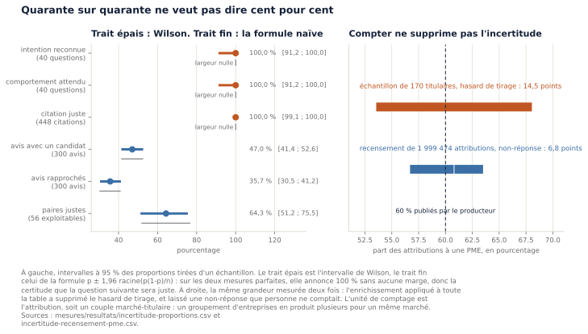
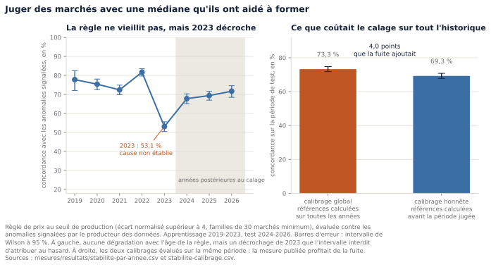

# Chapitre 11. Mesures, coûts et comparaison au marché

> Brouillon partiel. Les sections 11.1 à 11.3 sont rédigées. Les faits, chiffres et mesures sont
> vérifiés et reproductibles ; la formulation reste à reprendre dans la voix de l'auteur.

---

## 11.1 Ce que vaut un pourcentage

Les chapitres précédents annoncent des dizaines de pourcentages. Quarante intentions reconnues sur
quarante. Quatre cent quarante-huit citations vérifiées, zéro fausse. Quatre-vingt-cinq virgule six
pour cent de rapprochements justes. Soixante pour cent de marchés attribués à une PME.

Aucun de ces chiffres n'était accompagné d'une marge. Cette section explique pourquoi c'était un
défaut, et pourquoi le corriger a été plus intéressant que prévu.

### 11.1.1 Trois de ces chiffres ne sont pas des comptages

Un pourcentage calculé sur l'ensemble des deux millions de marchés est un **comptage** : il n'y a
pas de hasard du tirage, puisqu'il n'y a pas eu de tirage. Un pourcentage calculé sur un
sous-ensemble choisi est une **estimation** : il aurait été différent avec un autre sous-ensemble,
et cette variation se quantifie.

Trois mesures du projet sont des estimations :

| Mesure | Échantillon | Pourquoi un échantillon |
|---|---|---|
| intentions reconnues par l'assistant | 40 questions | écrire et relire une question prend du temps |
| avis du BOAMP rapprochés à un marché | 300 avis | le rapprochement complet dure des heures |
| justesse du rapprochement | 60 paires relues à la main | un humain doit lire les deux libellés |

Publier « 85,6 % de rapprochements justes » sans marge revient à affirmer que relire soixante
autres paires donnerait à peu près le même chiffre. C'est précisément ce qu'il faut mesurer plutôt
que supposer.

### 11.1.2 La formule que tout le monde connaît échoue là où ce projet mesure

La marge d'une proportion s'écrit habituellement `p ± 1,96 racine(p(1-p)/n)`. Cette formule, dite
de Wald, est enseignée partout. Appliquée aux mesures de ce projet, elle produit deux
impossibilités.

| Mesure | Formule de Wald | Méthode de Wilson |
|---|---|---|
| 40 intentions reconnues sur 40 | [100,0 ; 100,0] | **[91,2 ; 100,0]** |
| 448 citations justes sur 448 | [100,0 ; 100,0] | [99,1 ; 100,0] |
| 1 succès sur 100 | **[-1,0 ; 3,0]** | [0,2 ; 5,4] |

La première ligne annonce que la quarante et unième question sera reconnue, c'est certain. La
troisième annonce qu'une proportion peut être négative.

La cause est la même dans les deux cas. Quand `p` vaut 0 ou 1, le produit `p(1-p)` vaut zéro, donc
la marge aussi. La formule suppose que la proportion observée est la vraie proportion, hypothèse
raisonnable au milieu de l'intervalle et fausse à ses bords. Or ce projet mesure beaucoup de choses
qui tombent aux bords : c'est même l'objectif, puisqu'une méthode de vérification est censée ne
jamais se tromper.

La méthode de Wilson, publiée en 1927, recentre la proportion observée vers 0,5 d'une quantité qui
décroît avec la taille de l'échantillon. L'intervalle reste donc à l'intérieur des valeurs
possibles, et il ne se referme jamais complètement. C'est la méthode retenue pour tout le mémoire.
L'intervalle binomial exact, dit de Clopper-Pearson, est calculé en contrôle ; il donne des bornes
légèrement plus larges, ce qui est attendu d'une méthode conservatrice.

> **Ce que « 40 sur 40 » autorise à dire.** Que la méthode reconnaît correctement l'intention dans
> au moins 91 % des cas de ce type, avec 95 % de confiance. Pas qu'elle ne se trompe jamais. La
> différence entre les deux énoncés est la différence entre une mesure et une publicité.

### 11.1.3 Quand il n'y a pas de formule : le rééchantillonnage

La justesse du rapprochement n'est pas une proportion simple. Elle est calculée sur un échantillon
**stratifié** : douze paires relues dans chacune des cinq tranches de similarité, alors que les
tranches n'ont pas le même poids dans la réalité. La justesse publiée est donc une moyenne
pondérée, et son dénominateur varie encore puisque les paires marquées « doute » en sont retirées.

Pour un estimateur de ce genre, il n'existe pas de formule de variance simple. On rééchantillonne :
on tire des paires à l'intérieur de chaque tranche, en gardant les effectifs, on recalcule la
justesse redressée, et on recommence dix mille fois. Les bornes de l'intervalle sont les centiles
2,5 et 97,5 des valeurs obtenues. C'est le **bootstrap stratifié**.

| Seuil de similarité | Paires relues | Justesse | Intervalle à 95 % | Largeur |
|---|---|---|---|---|
| 0,4 | 60 | 66,0 % | [59,3 ; 72,3] | 13,0 points |
| **0,5 (retenu)** | 48 | **85,6 %** | **[76,7 ; 94,0]** | 17,3 points |
| 0,6 | 36 | 94,1 % | [88,4 ; 98,7] | 10,2 points |
| 0,7 | 24 | 97,8 % | [92,7 ; 100,0] | 7,3 points |
| 0,8 | 12 | 100,0 % | [100,0 ; 100,0] | 0,0 point |

La décision de seuil tient : l'intervalle du seuil 0,5 ne chevauche pas celui du seuil 0,4, donc
l'écart entre les deux n'est pas du hasard. Mais la précision affichée du chiffre, 85,6 %, était
illusoire : il vaut plus ou moins neuf points.

### 11.1.4 Une méthode qui ne sait rien dire doit le dire

La dernière ligne du tableau mérite qu'on s'y arrête, parce qu'elle a failli produire le chiffre le
plus trompeur du mémoire.

Au seuil 0,8, les douze paires relues sont toutes justes. Le rééchantillonnage ne peut tirer que
des valeurs déjà présentes dans l'échantillon : s'il n'y en a qu'une, il la répète. Les dix mille
simulations donnent donc toutes exactement 100 %, et l'intervalle se referme sur un point.

**Un intervalle de largeur nulle se lit comme une certitude absolue. Il signale ici exactement
l'inverse : douze paires ne suffisent pas pour que la méthode ait prise sur la question.** Le cas
est détecté automatiquement, marqué dans le fichier de résultats, et l'intervalle binomial exact
prend le relais : [73,5 ; 100,0].

C'est une illustration générale, et elle vaut au-delà de ce projet : un résultat numérique
rassurant peut être le symptôme d'une méthode à bout, et seul un contrôle explicite fait la
différence.

### 11.1.5 L'incertitude qui ne vient pas du tirage

Il reste un piège, et c'est celui dans lequel cette section aurait pu tomber en entier : mettre un
intervalle de confiance sur tout.

Un intervalle de confiance ne mesure que le hasard du tirage. Il ne dit rien d'un échantillon mal
construit, d'une non-réponse, ni d'une étiquette approximative. Placé au mauvais endroit, il donne
un air de rigueur à une mesure dont le défaut est ailleurs.

Le cas de la part de PME le montre bien. Elle était estimée sur un échantillon de 170 titulaires
interrogés par l'API Recherche d'entreprises. L'enrichissement a depuis été appliqué à toute la
table : la part n'est plus estimée, elle est comptée, et elle vaut 60,8 %.

Une précision d'unité s'impose ici, et elle vaut d'être dite parce que c'est l'erreur la plus
facile à commettre sur ce jeu. L'unité de comptage est l'**attribution**, c'est-à-dire un couple
marché-titulaire : un groupement d'entreprises produit plusieurs attributions pour un seul marché.
La table en compte 1 999 474 pour 1 738 289 marchés distincts. À l'échelle du marché, 56,5 % des
marchés ont au moins une PME parmi leurs titulaires. Les deux chiffres sont justes et ne répondent
pas à la même question.

On pourrait croire que l'incertitude a disparu. Elle a changé de nature.

| Source d'incertitude | Largeur |
|---|---|
| hasard de tirage, échantillon de 170 titulaires | 14,5 points |
| non-réponse, recensement complet | 6,8 points |

6,8 % des titulaires n'ont pas été résolus par l'API, et leur catégorie reste inconnue. Aucune
formule ne dira ce qu'ils sont : on peut seulement encadrer, entre 56,7 et 63,5 %. L'incertitude a
diminué de moitié, elle n'a pas disparu, et elle est passée d'un hasard qui se calcule à une
non-réponse qui ne se corrige pas.

Le projet publie donc, pour chaque chiffre annoncé, la nature de la mesure et la source
d'incertitude qui domine.

| Chiffre | Nature | Incertitude dominante |
|---|---|---|
| part des attributions à une PME | recensement | non-réponse, 6,8 points |
| intentions reconnues par l'assistant | échantillon | tirage, et surtout la provenance des questions |
| avis du BOAMP rapprochés | échantillon | tirage |
| justesse du rapprochement | échantillon stratifié, redressé | tirage, sur 60 paires relues |
| concordance de la détection | recensement | étiquette approximative |
| pertinence des résultats de recherche | non mesuré | absence de jugement humain |
| latences | répétitions sur une machine | variabilité d'exécution |

Deux lignes de ce tableau méritent d'être lues ensemble. Les 40 questions de l'assistant ont été
écrites par l'auteur du système : l'intervalle de Wilson couvre le hasard du tirage, pas ce biais
de provenance. Et la pertinence des résultats de recherche n'a aucun chiffre, faute de jugement
humain. **Un chiffre absent est plus honnête qu'un chiffre inventé**, et il est écrit comme tel.

---

## 11.2 Une règle calée sur le passé tient-elle sur la suite ?

La section précédente a été écrite pour corriger un défaut connu. En la construisant, une seconde
faiblesse est apparue, qui n'était pas cherchée et qui coûte plus cher.

### 11.2.1 Le problème : juger un marché avec une médiane qu'il a aidé à former

La règle de détection de prix compare chaque marché à la médiane de sa famille d'achat, normalisée
par l'écart interquartile de cette famille. Ces deux quantités sont des **paramètres** : elles sont
estimées à partir des données.

Or elles sont estimées sur **toutes** les années, y compris celle du marché jugé. Un marché de 2026
est donc comparé à une médiane qu'il a lui-même contribué à former. C'est une fuite de données.

Le problème n'est pas qu'elle fausse énormément le résultat. Le problème est qu'on ne savait pas de
combien, faute de l'avoir mesuré.

### 11.2.2 Le protocole : découper par date, pas au hasard

| Option | Avantage | Limite | Verdict |
|---|---|---|---|
| **Découpage par date** | reproduit la seule situation réelle : juger des marchés postérieurs au calage | les périodes n'ont ni le même volume ni la même inflation | **retenu** |
| Tirage au hasard | périodes équilibrées | **autorise le futur à calibrer le passé**, situation qu'aucune mise en production ne reproduit | exclu |
| Validation croisée glissante | correcte, et plus stable qu'un découpage unique | plusieurs recalculs complets sur deux millions de lignes | reportée, voir 11.2.5 |

Les références sont recalculées sur les seules années 2019 à 2023, puis la règle est appliquée aux
années 2024 à 2026, qui n'ont servi à rien d'autre qu'à être jugées. Le seuil et la taille minimale
de famille sont ceux du modèle de production, et un test automatique vérifie qu'ils le restent :
mesurer la stabilité d'une autre règle que celle qui tourne donnerait un résultat vrai et sans
objet.

### 11.2.3 Le résultat : quatre points

| Calibrage | Période évaluée | Signalés | Concordance | Intervalle | Fuite |
|---|---|---|---|---|---|
| global, production actuelle | apprentissage | 5 073 | 78,0 % | [76,8 ; 79,1] | oui |
| global, production actuelle | test | 3 328 | 73,3 % | [71,8 ; 74,8] | oui |
| apprentissage seul | apprentissage | 5 415 | 70,8 % | [69,6 ; 72,0] | oui |
| **apprentissage seul** | **test** | **3 623** | **69,3 %** | **[67,8 ; 70,8]** | **non** |

À période d'évaluation identique, le calage sur l'historique complet ajoute **4 points** de
concordance, et les deux intervalles ne se chevauchent pas : l'écart n'est pas du bruit. Le chiffre
publié par le mémoire est désormais celui de la dernière ligne, 69,3 %.

Une nuance doit être dite, parce qu'elle contredit la lecture la plus simple. Le calibrage global
fait mieux sur les **deux** périodes, pas seulement sur celle qu'il a vue. Disposer de deux millions
de lignes pour estimer une médiane aide réellement. Une partie des quatre points vient de là,
l'autre de la fuite, et un découpage unique ne sait pas les séparer.

### 11.2.4 La règle ne vieillit pas, mais 2023 décroche

Si une règle calée une fois se dégradait avec le temps, la concordance baisserait année après année
après la coupure. Ce n'est pas le cas : les trois années postérieures au calage sont même en légère
hausse.

| Année | Concordance | Intervalle | Étiquetés par le producteur |
|---|---|---|---|
| 2021 | 72,4 % | [69,9 ; 74,9] | 2,84 % |
| 2022 | 81,7 % | [79,7 ; 83,5] | 3,35 % |
| **2023** | **53,1 %** | **[50,5 ; 55,6]** | 2,71 % |
| 2024 | 67,8 % | [65,1 ; 70,3] | 2,46 % |
| 2025 | 69,4 % | [67,0 ; 71,6] | 2,52 % |
| 2026 | 71,7 % | [68,5 ; 74,6] | 3,03 % |

L'année 2023 chute de vingt-huit points, et les intervalles de 2022 et 2023 sont séparés de plus de
vingt points : ce n'est pas du hasard d'échantillonnage.

L'explication qui vient d'abord est que le producteur des données a changé sa pratique de
signalement cette année-là. Elle ne tient pas : la part de marchés qu'il signale baisse encore en
2024, où la concordance remonte à 67,8 %.

**La cause n'est pas établie, et elle est publiée comme telle.** Déterminer ce qui s'est passé en
2023 demande d'ouvrir les lignes, ce qui est un travail en soi.

### 11.2.5 Ce que cette mesure dit de sa propre faiblesse

Le résultat le plus utile de cette section n'est pas les quatre points de fuite. C'est le rapport
entre deux nombres.

La variation d'une année à l'autre atteint vingt-huit points. L'effet que la mesure cherchait à
quantifier en vaut quatre. **Le bruit de fond est sept fois plus grand que le signal mesuré.**

Un découpage unique en deux périodes est donc une réponse faible à la question posée : le résultat
dépend de l'endroit où la coupure tombe. Une validation glissante, qui recalerait les références
chaque année et moyennerait les résultats, est la suite logique. Elle est inscrite au carnet plutôt
que présentée comme faite.

### 11.2.6 Un défaut de production découvert en chemin

Trente et une familles d'achat sur cinquante-sept voient leur médiane de prix bouger de plus de
26 % entre les deux périodes. Les plus mobiles sont aussi celles dont l'effectif s'effondre : la
famille 93 passe de 1 556 marchés à 31, la famille 76 de 226 à 73. Leur médiane n'est plus estimée
sur la même chose.

Or le modèle de production vérifie la taille minimale de famille sur **l'historique complet**, pas
sur la période jugée. Une famille devenue trop rare continue donc d'être évaluée avec une référence
estimée sur autre chose.

Ce défaut n'est pas corrigé dans cette phase : la correction change les chiffres de la détection et
mérite sa propre mesure. Il est inscrit au carnet, et il illustre un enseignement qui traverse tout
le mémoire : **chercher une faiblesse en révèle d'autres**. Cette session cherchait des intervalles
de confiance. Elle a trouvé une fuite de données, un décrochage annuel inexpliqué, et un défaut du
modèle de production. Aucun des trois n'était visible sans la mesure.

---

## 11.3 Ce que cela coûte, et ce que cela coûterait ailleurs

La thèse de ce mémoire tient en une phrase : une plateforme de qualité professionnelle, sécurisée
et maintenable, pour une fraction du coût des offres gérées. Une affirmation pareille se vérifie
ou s'effondre sur la manière dont la comparaison est posée. Cette section pose la comparaison,
puis la chiffre, puis dit ce qu'elle ne prouve pas.

### 11.3.1 Trois façons de tricher, et comment la mesure les évite

**Comparer deux choses différentes.** « AWS contre un serveur privé virtuel » ne veut rien dire
dans l'absolu : tout dépend de ce qu'on y met. La comparaison porte ici sur une charge précise et
mesurée, celle de ce projet : une base PostgreSQL de 2 481 mégaoctets, un service applicatif de
37 mégaoctets de mémoire résidente, un plafond mesuré de 89 requêtes par seconde, et les limites
de processeur et de mémoire réellement déclarées dans la configuration des conteneurs. Aucun de
ces chiffres n'est estimé : ils sont lus par le script de mesure, qui interroge la base pour sa
taille et reprend les autres dans les résultats des bancs d'essai précédents.

**Comparer des prix invérifiables.** Les tarifs du nuage changent, varient par région et
diffèrent fortement entre la vitrine commerciale et la facture. Chaque tarif utilisé ici provient
d'une **source officielle et lisible par une machine**, avec sa référence exacte, sa région, sa
devise et sa date de relevé : la liste de prix publique d'AWS pour la région de Paris, l'interface
de tarification au détail d'Azure pour la région France Centre, la page de tarification de Google
Cloud, et le catalogue public d'OVHcloud. Ils sont versionnés dans le dépôt, de sorte qu'un
lecteur peut les reprendre un par un. Aucun prix ne provient d'un comparateur tiers ni d'un
article de blog.

**Oublier ce que l'argent achète.** C'est la tricherie la plus fréquente et la plus grave. Une
base de données gérée n'est pas un serveur plus cher : elle apporte des sauvegardes automatiques
et testées, un basculement en cas de panne, des correctifs de sécurité appliqués sans
intervention, un engagement contractuel de disponibilité et un interlocuteur à appeler. Le
tableau ci-dessous chiffre le prix ; le paragraphe qui le suit dit ce que ce prix couvre, car un
chiffre seul mentirait par omission.

### 11.3.2 Le résultat

| Scénario | Fournisseur | Euros par mois, hors taxes |
|---|---|---|
| Serveur privé virtuel minimal, tout sur une machine | OVHcloud | **17,50** |
| **Serveur privé virtuel retenu**, tout sur une machine | OVHcloud | **23,50** |
| Base gérée seule, borne basse | Google Cloud | 90,90 |
| Service géré et base gérée | AWS | **119,44** |
| Service géré et base gérée | Azure | **121,64** |
| Base gérée seule, borne haute | Google Cloud | 176,34 |

*Source : `make bench-couts`, tarifs relevés le 22 octobre 2026, taux de change de la Banque
centrale européenne du même jour. Sans engagement, sans réservation, sans remise de volume.
Figure 26.*

La solution retenue coûte **23,50 euros par mois**, soit 282 euros par an, contre 119,44 euros
pour l'offre gérée complète la moins chère : un rapport de **5,1**. Les deux lignes de Google
Cloud sont marquées à part et hachurées sur la figure, parce qu'elles ne couvrent **que la base
de données** : la machine qui sert les pages n'y est pas comprise. Les confondre avec les offres
complètes ferait passer une offre partielle pour la moins chère.

Deux précisions de méthode s'imposent sur Google Cloud. Sa page de tarification publie plusieurs
jeux de prix sans que le code source de la page permette de déterminer à quelle région chacun
correspond ; le projet publie donc une fourchette plutôt qu'un chiffre, et la borne basse est
celle qui avantage le fournisseur. Cette fourchette va du simple à près du double, ce qui est en
soi une information sur la difficulté de comparer des tarifs de nuage.

### 11.3.3 Ce que l'écart achète réellement

Les 96 euros mensuels d'écart entre le serveur privé virtuel et l'offre AWS ne sont pas une
marge sans contrepartie. Ils achètent quatre choses que le projet devra assurer lui-même :

**Les sauvegardes.** Une base gérée les prend, les conserve et permet une restauration à un
instant donné. Sur le serveur privé virtuel, c'est un travail de la phase 9, et une sauvegarde
qui n'a jamais été restaurée n'est pas une sauvegarde.

**Le basculement.** Une offre en haute disponibilité redémarre le service sur une autre machine
quand la première tombe. Le chiffrage ci-dessus retient délibérément les configurations à une
seule zone, qui n'offrent pas cette garantie : les prendre en haute disponibilité doublerait
approximativement la facture gérée, et creuserait l'écart au lieu de le réduire. Le serveur
privé virtuel, lui, n'offre aucune garantie de ce type à aucun prix.

**Les correctifs.** Les mises à jour du système et du moteur de base de données sont appliquées
par le fournisseur. Sur le serveur privé virtuel, elles relèvent de l'exploitation.

**Un interlocuteur.** Un engagement contractuel de disponibilité et un support technique. Un
projet d'étude peut s'en passer ; une organisation qui dépendrait de ce service, non.

À cela s'ajoute le coût le plus souvent omis dans ce genre de comparaison, et qui ne figure dans
aucune des deux colonnes : **le temps d'ingénierie**. Les heures consacrées à écrire la collecte,
le nettoyage, la détection, la recherche, l'interface et leur exploitation ne disparaissent pas
parce qu'elles ne sont pas facturées. Elles sont simplement payées en temps plutôt qu'en euros.
Le chapitre 13 y revient, parce que c'est la limite honnête de la thèse défendue ici.

### 11.3.4 L'échelle à laquelle ce résultat s'inverse

Ce calcul porte sur **un** service, deux millions de lignes et une centaine de requêtes par
seconde au plus. Trois seuils renverseraient la conclusion.

**Le volume.** Au-delà de quelques téraoctets, la gestion du stockage, des sauvegardes et des
restaurations cesse d'être une tâche annexe. Le projet en est à 2,4 gigaoctets.

**La charge.** Au-delà de quelques milliers de requêtes par seconde, l'élasticité d'une offre
gérée cesse d'être un confort et devient la seule réponse praticable. Le plafond mesuré de ce
service est de 89 requêtes par seconde sur une machine de développement.

**Le coût du temps.** Dès que le temps d'exploitation est facturé au prix d'un ingénieur, les
96 euros d'écart mensuel représentent moins d'une heure de travail. Une organisation qui paie ce
temps a tout intérêt à acheter ce qu'elle peut acheter.

Autrement dit, le résultat de cette section ne dit pas que les offres gérées sont chères. Il dit
qu'**à cette échelle, pour cet usage, elles ne sont pas nécessaires**, et il chiffre de combien.

### 11.3.5 Trois offres que ce mémoire ne chiffre pas

Databricks, Snowflake et OpenAI figurent dans le cahier des charges de ce mémoire parmi les
offres auxquelles l'approche doit être comparée. Elles ne sont pas chiffrées ici, et la raison
mérite d'être dite plutôt que contournée : **aucune des trois ne publie de tarif sous une forme
vérifiable sans ouvrir un compte**. Leurs pages de tarification construisent leurs tableaux dans
le navigateur, et aucune n'expose de liste de prix publique comparable à celle d'AWS ou
d'Azure. Vérifié le 22 octobre 2026.

Le projet ne publie donc aucun chiffre pour ces trois offres, plutôt qu'un chiffre repris d'un
comparateur tiers. Cette absence est elle-même un résultat : parmi six fournisseurs examinés,
trois rendent leurs prix vérifiables par un tiers et trois non, et cette asymétrie est une donnée
pour quiconque compare avant d'acheter.

Une comparaison qualitative reste possible et sera faite dans le chapitre d'architecture : le
projet n'a lancé aucun traitement distribué, n'a jamais eu recours à un entrepôt de données
séparé, et n'a appelé aucun modèle de langue. Les trois offres répondent à des besoins que ce
projet, à sa taille, n'a pas rencontrés. Le chiffrer demanderait d'abord d'inventer ces besoins.
